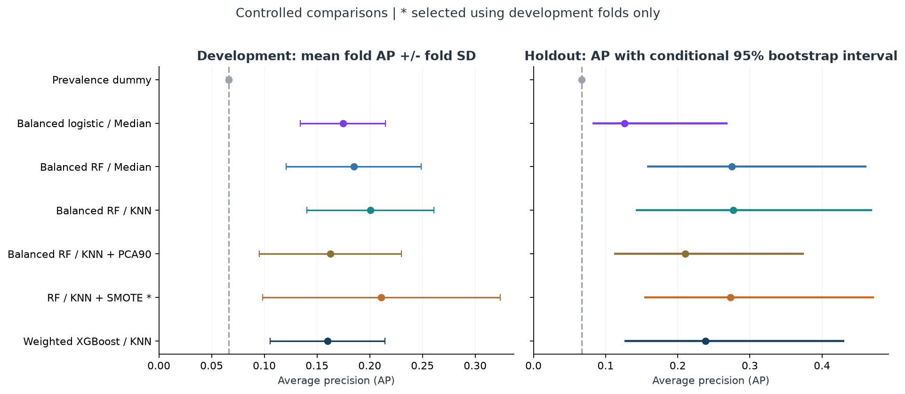
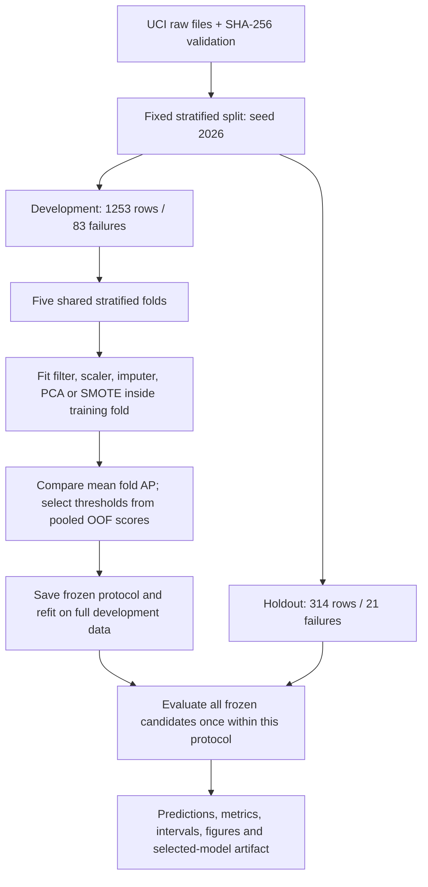
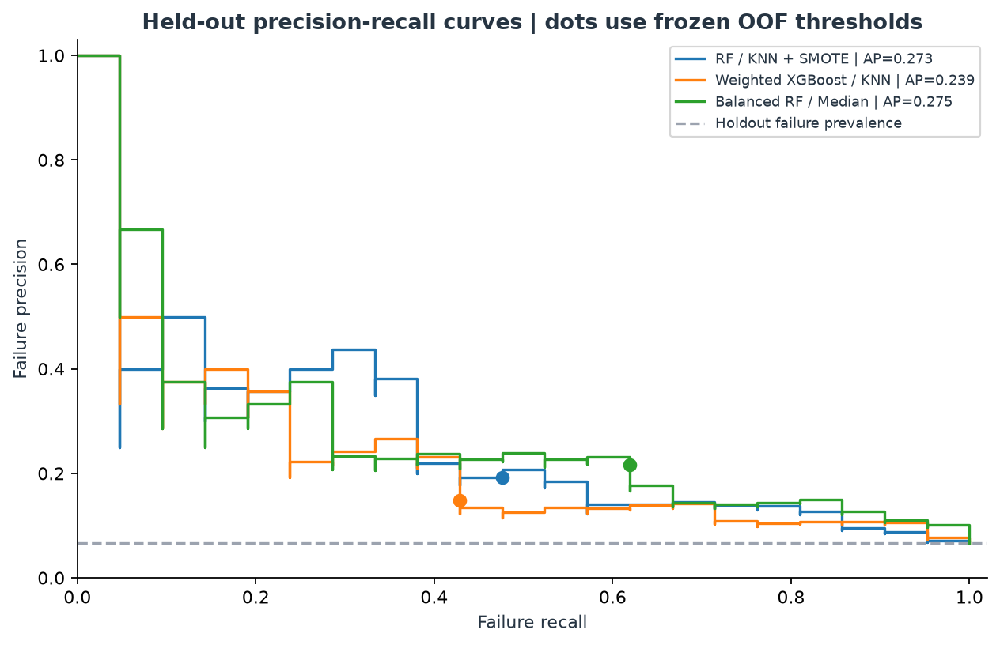

# Semiconductor Yield Anomaly Detection

A personal investigation of missing sensor measurements, rare failures, and decision thresholds on **UCI SECOM**.

I built this project around a deceptively simple problem: predicting every observation as a pass produces about **93.4% accuracy**, while detecting **none of the failures**. I wanted to understand which parts of a machine-learning pipeline actually improve failure detection, and how much confidence I could place in the result.

The investigation keeps my original route: **Median vs. KNN imputation -> PCA -> SMOTE -> weighted XGBoost -> threshold tradeoffs -> sensor interpretation**. The revised implementation adds controlled comparisons, fold-local preprocessing, a frozen evaluation boundary, and enough saved evidence to reconstruct the reported numbers.

**Start here:** [executed notebook](main.ipynb) | [generated results](results/RESULTS.md) | [experiment protocol](docs/11_experiment_protocol.md) | [project journal](docs/12_project_journal.md)



## What The Experiment Found

The predefined selection rule chose **Random Forest + KNN + SMOTE** using mean development-fold average precision (AP). XGBoost remains part of the investigation; the code does not assume it must win.

| Selected pipeline: RF / KNN + SMOTE | Result |
|---|---:|
| Mean development-fold AP | 0.2110 |
| Development-fold AP standard deviation | 0.1128 |
| Holdout AP | 0.2727 |
| Constant-score holdout AP reference | 0.0669 |
| Precision at frozen OOF threshold | 0.1923 |
| Recall at frozen OOF threshold | 0.4762 |
| F1 at frozen OOF threshold | 0.2740 |
| Detected failures | 10 / 21 |
| False alarms | 42 / 293 passing observations |

These results show useful ranking signal, with considerable uncertainty and a substantial false-alarm burden. The selected pipeline's conditional 95% AP interval is **[0.1534, 0.4720]**; its failure-recall Wilson interval is **[0.2834, 0.6763]**. This is an offline diagnostic study, not evidence of factory readiness.

An important counterexample: Median + Random Forest obtained **0.3210 holdout F1**, above the selected pipeline's 0.2740. I retain the development-selected model rather than change the winner after seeing test results. The full comparison, including XGBoost and the chronological sensitivity check, is in the [generated report](results/RESULTS.md).

## Questions I Worked Through

| Question | Controlled comparison | What I can conclude |
|---|---|---|
| Does local imputation help? | The same balanced RF with Median or KNN | Compare observed ranking and operating points; do not assume KNN is inherently better |
| Does retaining 90% variance retain failure signal? | RF / KNN with and without fold-fitted PCA90 | Variance retention is an unsupervised objective, not a guarantee of discrimination |
| Does oversampling help? | RF / KNN with and without training-only SMOTE | SMOTE was selected in this run, but its fold variation is large |
| Does a weighted boosting model improve ranking? | Fixed, regularized XGBoost against simple and RF baselines | Weighting and model complexity need evidence; they do not guarantee calibrated risk |
| What changes when I move the threshold? | Default 0.5 vs. development-OOF-selected threshold | Report recovered failures together with the extra alerts |
| Do results transfer forward in time? | Fixed XGBoost on an earlier/later development split | A separate sensitivity check; one random split is not a deployment simulation |

Zero F1 at threshold 0.5 does not prove that a model has no ranking signal. That distinction changed how I interpret my original PCA and SMOTE experiments.

## Evaluation Design



The seven candidates are a prevalence dummy, balanced logistic regression with Median imputation, RF/Median, RF/KNN, RF/KNN/PCA90, RF/KNN/SMOTE, and weighted XGBoost/KNN.

- **Preprocessing:** training-only missingness/constant-column filtering, then training-fitted standardization before imputation. This gives KNN distances a common scale. Evaluation data never fit a scaler or supply imputation donors.
- **PCA:** retain 90% training variance separately in each fit. No historical component count is hardcoded.
- **SMOTE:** create synthetic observations only within the training partition. Evaluation rows and their class prevalence remain unchanged.
- **Model choice:** maximum mean fold AP, with fixed candidate order breaking exact ties.
- **Threshold choice:** maximum pooled development OOF failure F1; exact count-based ties retain the highest threshold. No holdout labels participate.
- **Freeze:** write `protocol.json` before holdout scoring. The CV-selected winner remains selected even if the holdout ordering differs.
- **Uncertainty:** class-stratified fixed-score AP bootstrap and failure-recall Wilson intervals. Neither captures all training, model-selection, or future-drift uncertainty.

AP means `average_precision_score`, not trapezoidal precision-recall area. OOF threshold F1 is a development optimization result, not an independent performance estimate. Model scores are not presented as calibrated failure probabilities.



## Run It

Use **Python 3.12** and [uv](https://docs.astral.sh/uv/). The repository includes `uv.lock`; no GPU is required.

```bash
git clone https://github.com/Paul-Lai0111/semiconductor-yield-anomaly-detection.git
cd semiconductor-yield-anomaly-detection
uv sync --locked
uv run python main.py --overwrite
```

The first run downloads the original UCI archive into ignored `data/raw/` and verifies both raw-file hashes. The default study uses five development folds, 300 trees for the RF and XGBoost candidates, two CPU threads, and 2,000 bootstrap resamples. Its first execution can take several minutes, including plotting/font initialization.

Published results are already included, so `--overwrite` explicitly replaces that run. To execute the notebook and quality checks afterward:

```bash
uv run python scripts/execute_notebook.py
uv run pytest
uv run ruff check .
```

For a separate integration run with a smaller compute budget:

```bash
uv run python main.py --trees 30 --folds 2 --bootstrap 50 --skip-temporal --output artifacts/smoke
```

Custom runs keep their metrics, figures, and model under their own output directory. They do not replace the published figures or selected model. An existing nonempty run directory is protected unless `--overwrite` is supplied. A reduced run is a code check, not a reproduction of the published five-fold study.

`requirements.txt` is an exact runtime export for pip users. Development checks and notebook execution use the locked uv development environment. See `python main.py --help` for all options.

## Inspect The Evidence

| File | Why I save it |
|---|---|
| [results/RESULTS.md](results/RESULTS.md) | Readable comparison, uncertainty, and chronological sensitivity |
| [results/protocol.json](results/protocol.json) | Configuration, candidate parameters, frozen model choice and thresholds |
| [results/split_manifest.csv](results/split_manifest.csv) | Original row identity, partition, timestamps, class labels and validation folds |
| [results/fold_metrics.csv](results/fold_metrics.csv) | Per-fold AP, support, retained sensors, PCA dimensions and runtime |
| [results/oof_predictions.csv](results/oof_predictions.csv) | Reconstruct development comparisons and threshold selection |
| [results/holdout_predictions.csv](results/holdout_predictions.csv) | Reconstruct final scores, confusion counts and operating-point metrics |
| [results/metrics.json](results/metrics.json) | Structured results, conditional intervals, environment and source hashes |
| [results/feature_importance.csv](results/feature_importance.csv) | XGBoost's development-trained gain ranking with original sensor IDs |

The notebook reads these artifacts, checks the split/selection boundaries, independently reconstructs metrics from predictions, and displays current figures. It does not silently train a different experiment or optimize a new threshold on the holdout.

## Use The Saved Pipeline

After running the study, `artifacts/selected_model.joblib` contains the full-development refit, its frozen threshold, original sensor schema, configuration, and protocol hash. It is generated locally rather than committed.

```python
import joblib
import pandas as pd

bundle = joblib.load("artifacts/selected_model.joblib")
measurements = pd.read_csv("new_measurements.csv")
X = measurements.loc[:, bundle["sensor_columns"]]
scores = bundle["pipeline"].predict_proba(X)[:, 1]
alerts = scores >= bundle["threshold"]
```

Inputs must use the same sensor definitions, units, and ordered names (`sensor_000` through `sensor_589`). This is a reproducible inference interface for the study, not a validated production monitoring service.

## What Changed From My First Version

The first version searched a precision-recall curve on the test set and reported the best threshold on that same set. It also filtered sensors before splitting, fit a separate test scaler in the Median branch, and used unscaled KNN distances. Those choices weakened the comparison.

This revision keeps the investigation but changes the evidence standard. I removed the unsupported blanket claim that KNN improves on Median by 50%, stopped treating PCA/SMOTE failure mechanisms as established facts, and made XGBoost earn its comparison rather than naming it the final winner in advance. The old threshold 0.0159 and F1 0.36 are historical exploratory results; comparing them directly with the revised holdout F1 would conflate several protocol changes.

The code is now split into data validation, pipeline definitions, evaluation, experiment orchestration, and reporting. Regression tests cover leakage boundaries, standardized KNN geometry, training-only SMOTE, class weights, exact F1 ties, data corruption, output isolation, serialization, and report consistency. GitHub Actions runs the locked lint/test checks.

## Limits And Next Questions

- **Small failure support:** there are only 21 failures in the main holdout. One additional detected failure changes recall by approximately 4.8 percentage points.
- **Previous exploration:** SECOM was used in the original project. The revised holdout is excluded from fitting and selection within this protocol; it is not historically unseen data.
- **Dependence and time:** the random split assumes exchangeability. Tool/lot identifiers are unavailable. The fixed-XGBoost chronological check is a narrower test and does not validate every candidate's future performance.
- **Threshold transfer:** OOF models and the full-development refit can have different score distributions. A threshold selected honestly can still transfer poorly.
- **Unknown economics:** failure costs, inspection capacity, and prevalence under deployment are unspecified. F1 is an explicit experimental rule, not a factory cost model.
- **Interpretation:** sensor IDs are anonymous. Training gain importance is not physical causality, a maintenance recommendation, or evidence that a 15-sensor model would retain performance.

The next experiments I would prioritize are repeated/forward validation, an externally specified inspection-cost or capacity objective, and probability calibration evaluated without reusing the final test labels. These are future questions, not capabilities claimed by this repository.

## Project Map

```text
main.py                    CLI entry point
main.ipynb                 Executed investigation and artifact checks
secom/data.py              UCI download, checksum and schema validation
secom/modeling.py          Training-only preprocessing and seven candidates
secom/evaluation.py        Metrics, exact threshold policy and intervals
secom/experiment.py        Shared folds, freeze, refits and temporal check
secom/reporting.py         Figures and generated results
tests/                     Statistical-boundary and orchestration regressions
docs/                      Thirteen chapters following the diagnostic journey
results/                   Committed protocol, predictions and measurements
images/                    Eight figures from the same run
```

## Data Attribution

Michael McCann and Adrian Johnston (2008), **SECOM**, UCI Machine Learning Repository. [DOI: 10.24432/C54305](https://doi.org/10.24432/C54305). Dataset license: **CC BY 4.0**.

The raw feature file contains 590 numeric sensor columns; timestamps are supplied with the labels and are kept outside the predictor matrix. See [data/README.md](data/README.md) for integrity hashes and source handling.
