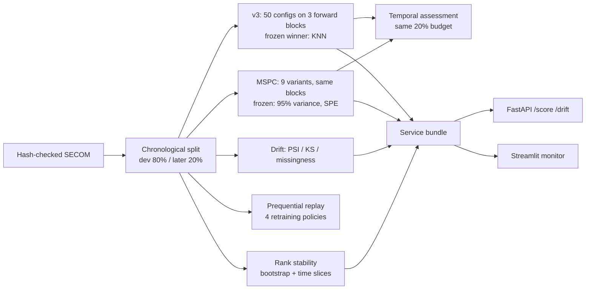
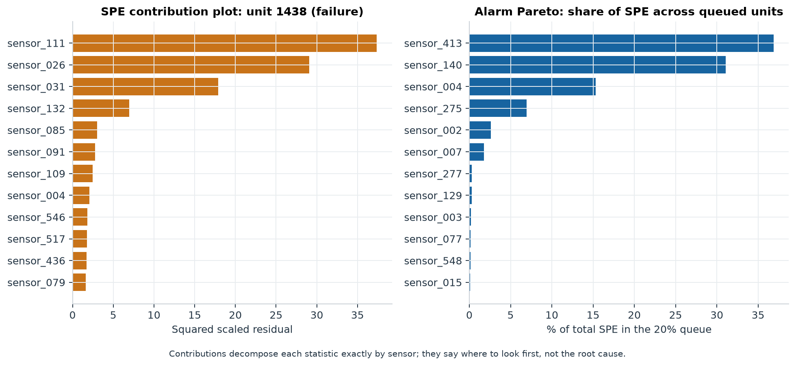
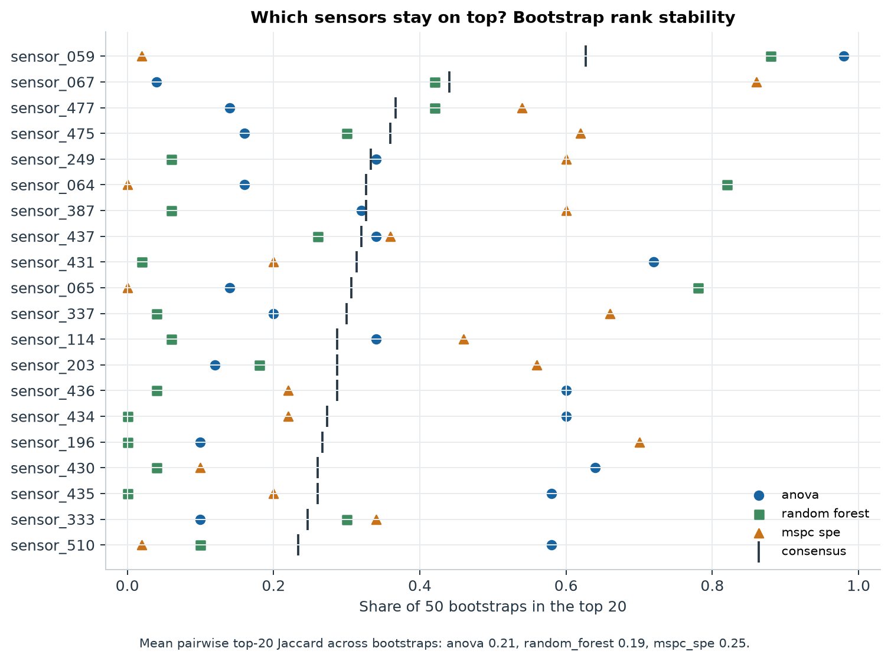

# Semiconductor Failure Detection for Smart Manufacturing

**Which units should a fab inspect when only 20% of a batch can be reviewed, and what does it take to keep that decision working as the process drifts?**

**[Open the live monitor](https://semiconductor-yield-anomaly-detection-paullai.streamlit.app/)** · by **Paul Lai**, M.S. in Data Science, UC San Diego · [holai@ucsd.edu](mailto:holai@ucsd.edu)

Using UCI SECOM (1,567 units, 590 anonymised sensors, 104 failures), I built the full path from model search to an engineer-facing tool:

1. A **frozen, chronological search** over 50 detector configurations (v3).
2. A comparison against the **industry-standard FDC baseline**, MSPC: PCA with Hotelling T² and SPE.
3. **Drift monitoring** and a **prequential simulation of retraining policies** under label delay.
4. **Bootstrap and time-slice stability** of "important sensor" rankings.
5. A **FastAPI batch-scoring service**, a Docker image, and a **Streamlit monitor**.

Results are written up as an [engineering report](docs/16_engineering_report.md): problem → current practice → proposal → benefit → risks → go-live conditions.

[Engineering report](docs/16_engineering_report.md) | [Fab-monitoring results](fab_monitoring_results/RESULTS.md) | [v3 model-search results](manufacturing_results/RESULTS.md) | [Executed notebook](manufacturing_notebook.ipynb) | [Protocol](docs/15_smart_manufacturing_protocol.md)


## Findings at a glance

| Question | Answer from this data | Evidence |
|---|---|---|
| Does a bigger model search beat the previous recipe on later data? | **No.** The selected KNN catches 5 / 17 later failures in 62 reviews, the same as the v2 recipe. | [v3 results](manufacturing_results/RESULTS.md) |
| Does the supervised ranking beat what fabs already run (MSPC)? | **Yes, at every budget.** 5 vs 2 failures at 20%, 10 vs 3 at 50%. MSPC with textbook 99% limits alarms on 72% of later passing units. | [§1](fab_monitoring_results/RESULTS.md#1-mspc-baseline-vs-supervised-ranking-same-frozen-split-same-20-budget) |
| Is the process stable? | **No.** 58–82% of sensors drift (PSI > 0.25) in every 100-unit batch, against a random-split noise floor of ≤ 7.5%. | [§2](fab_monitoring_results/RESULTS.md#2-drift-monitoring) |
| Does retraining help? | **Direction yes, significance no.** In the replay, frozen catches 10 / 46, periodic (3 retrains) 14 / 46, always (9 retrains) 15 / 46; sign test p ≥ 0.45. A drift trigger fires on every batch. | [§3](fab_monitoring_results/RESULTS.md#3-retraining-policies-prequential-labels-delayed-one-batch) |
| Can we name "the sensors that matter"? | **Not reliably.** Top-20 overlap is about 0.2 across bootstraps and about 0.01 across time slices. One sensor (`sensor_059`) is stable. | [§4](fab_monitoring_results/RESULTS.md#4-sensor-ranking-stability) |

**Recommendation:** run a shadow-mode pilot. Order the queue with the supervised ranking, use MSPC contributions as the diagnostic view, retrain on a schedule, and do not use fixed MSPC limits as the alarm rule on this process.

## The production question

Predicting pass for everything gives about 93.4% accuracy and catches no failures, so every method here is judged by **failures caught at a fixed inspection budget**, together with the review workload. The concrete application is inspection prioritisation: rank a completed batch, then review exactly `floor(20% × batch)` units.

The target is the recorded pass/fail outcome, so the main detectors are supervised. MSPC, Isolation Forest and One-Class SVM are pass-only references. SECOM has no lot, tool or wafer identifiers and does not say when each sensor is measured, so decision-time availability and intervention effectiveness are **go-live conditions**, not assumptions I can verify.

## Architecture



| Package | Responsibility |
|---|---|
| [`secom/`](secom/) | Download and hash-check the UCI files; legacy v2 study |
| [`smartfab/`](smartfab/) | v3 frozen search, review policies, chronological splits, batch CLI. **Source-hashed: unchanged in v4.** |
| [`fabops/mspc.py`](fabops/mspc.py) | PCA monitoring model, T² and SPE limits, exact per-sensor contributions |
| [`fabops/drift.py`](fabops/drift.py) | PSI with a missing-value bin, KS with Benjamini-Hochberg, missing-rate change |
| [`fabops/retraining.py`](fabops/retraining.py) | Test-then-train replay: frozen / periodic / drift-triggered / always, with label delay |
| [`fabops/stability.py`](fabops/stability.py) | ANOVA, random-forest and MSPC-SPE rankings over 50 bootstraps and 4 time slices |
| [`fabops/service.py`](fabops/service.py), [`fabops/api.py`](fabops/api.py) | Deployable bundle, input validation, inspection queue, FastAPI endpoints |
| [`dashboard/app.py`](dashboard/app.py) | Streamlit monitor: queue, alarm Pareto, control charts, drift, budget slider, watchlist |

## 1. Current practice: MSPC

The MSPC model is fitted on development **passes only**, with training-local sensor pruning, median imputation and z-scoring. The T² limit comes from the F distribution; the SPE limit uses Box's g·χ²(h) approximation. Contributions decompose each statistic exactly by sensor, and the tests check that they sum back to T² and SPE.

The nine variants (80/90/95% variance × T² / SPE / combined) were selected with **the same development objective as v3** and frozen before the later block was scored.

| Later block, 62 reviews | Failures caught / 17 | Passing units flagged | Average precision |
|---|---:|---:|---:|
| Supervised ranking (frozen v3 KNN) | **5** | 57 | 0.068 |
| MSPC (`mspc_var95_spe`) | 2 | 60 | 0.041 |
| Hybrid rank blend | 3 | 59 | 0.053 |
| Random review, expected | 3.36 | – | – |


**Takeaway:** the SPE cloud lifts above its limit right at the assessment boundary. MSPC is detecting that the process has moved, not that a unit will fail. The two detectors catch mostly different failures (KNN only 4, MSPC only 1, both 1). That is why MSPC is kept as the **diagnostic view**: contribution plots and an alarm Pareto that tell an engineer where to look.



## 2. Drift monitoring


PSI uses 10 reference-quantile bins plus a missing-value bin, so a sensor that starts dropping out also counts as drift. Small batches make PSI noisy: under no drift, the expected PSI is about (bins − 1)·(1/n + 1/m), roughly 0.1 for a 100-row batch. I therefore measured the noise floor directly. Random 100-row splits of one window flag at most 7.5% of sensors, while the last 100 rows *in time* of the same window flag 51%.

**Takeaway:** drift on SECOM is continuous rather than episodic. A trigger set against the original training window is uninformative because it is always on.

## 3. Retraining policies


The replay covers 1,100 units in 100-unit batches. Each batch is scored by the model in production *before* it can be trained on, and labels arrive one batch late. Every retrain uses all labelled data available at that moment.

**Takeaway:** retraining moves the supervised model from roughly random (10 caught vs 9.2 expected) to 14–15 caught. Periodic retraining gets most of that with a third of the retrains. With 46 failures the difference is not statistically significant (sign test p ≥ 0.45), and the report says so.

## 4. Which sensors should engineers check first?



A single feature-importance run on 87 failures is not trustworthy, so I measured how unstable it is. Each method keeps a different top 20 on each resample (Jaccard about 0.2), almost nothing survives across time slices (about 0.01), and the three methods barely agree with each other (≤ 0.05). The output is a **watchlist with stability tiers**: 1 stable sensor, 17 moderate. It is a prioritised checklist, not a root-cause claim.

## Using the live monitor

[The live monitor](https://semiconductor-yield-anomaly-detection-paullai.streamlit.app/) replays the frozen 314-unit assessment block, whose pass/fail outcomes are known, so you can see what the queue would have caught. The first visit after a quiet period takes about a minute while the app rebuilds its models.

1. **Read the opening sentence.** It gives the queue size and the recorded failures it contains, next to random inspection and MSPC control limits.
2. **Read the wafer map.** Each cell is one unit, in time order along a serpentine probe path (SECOM has no die positions, so this is a batch map, not a spatial one). Red filled cells are caught failures, red outlined cells are missed failures, dark cells are passing units the queue flagged, and pale cells were not queued.
3. **Click a cell**, or use *Previous* and *Next*. The panel shows that unit's rank, its T² and SPE against their 99% limits, and the sensors contributing most to its SPE.
4. **Change the sidebar controls** (the » button on a phone): the inspection budget from 5% to 50%, the ranking (frozen ML KNN, MSPC SPE, or a rank blend), and whether recorded outcomes are shown.
5. **Use the tabs.** *Queue* lists the inspection queue and downloads the scored batch as CSV. *Alarms* is the sensor Pareto, *Control charts* shows T² and SPE with limits, *Drift* shows PSI against the training window, *Budget* plots failures found against budget for every policy, *Watchlist* lists the stability-tiered sensors, and *About* summarises the project.
6. **Score your own batch.** Upload a CSV with the 590 columns `sensor_000` … `sensor_589` and an optional unique integer `unit_id`; blank cells are missing values. *How to use this monitor* on the page offers a 20-unit sample file in the exact format. Outcomes are never read from uploads, so the outcome views are demo-only.

| Wafer bin | Meaning |
|---|---|
| Red, filled | Recorded failure inside the inspection queue (caught) |
| Red, outlined | Recorded failure outside the queue (missed) |
| Dark | Passing unit inside the queue (false alarm) |
| Pale | Not queued |

## 5. The service

```bash
uv sync --locked                               # frozen research environment
uv pip install -r requirements-service.txt     # pinned serving overlay (FastAPI, Streamlit)
uv run python -m fabops.service build          # refits the frozen recipes on the development window
uv run uvicorn fabops.api:app --port 8000      # http://localhost:8000/docs
uv run streamlit run dashboard/app.py          # engineer dashboard
```

| Endpoint | Purpose |
|---|---|
| `GET /health`, `GET /model` | Liveness; provenance of the frozen models, control limits and watchlist |
| `POST /score?policy=v3_selected_knn&review_fraction=0.2` | JSON records → ranked queue with `review`, T²/SPE alarms, top SPE sensors |
| `POST /score/csv` | The same for an uploaded CSV |
| `POST /drift` | Per-sensor drift summary against the training window, with a warning flag |

Inputs are validated: exact sensor schema, unique integer `unit_id`, numeric or blank values, no infinities, and no fully empty rows. Decisions do not depend on row order, because ties break on a hash of `unit_id`.

```bash
docker build -t fab-monitor .
docker run --rm -p 8000:8000 fab-monitor
docker compose up            # API on :8000, dashboard on :8501
```

The dashboard also runs on Streamlit Community Cloud with entry point `dashboard/app.py` and Python 3.12. It rebuilds the bundle from the committed frozen selections on first load.

## Foundation: the v3 frozen model search

v3 compared 50 fixed base configurations and a predeclared rank blend: forests, boosting, SVMs, linear and discriminant models, nearest neighbours, and pass-only novelty detectors. Every candidate used the same three expanding forward blocks inside the earliest 80% of time. The objective was failures caught at an exact 20% review budget, with AP as the tie-break. The protocol, catalog and source hashes were saved **before the search**, and the winner and secondary threshold were saved **before the later block was scored**.

| Later block (314 units, 17 failures) | Selected KNN | v2 recipe refitted |
|---|---:|---:|
| Failures caught in 62 reviews | 5 | 5 |
| Review precision | 8.1% | 8.1% |
| Average precision | 0.068 | 0.077 |

Random review of 62 units catches 3.36 failures in expectation (95% range 1–7). The development-selected winner did not beat the previous recipe; the project reports that outcome rather than picking a new winner after seeing the assessment. Full details: [v3 results](manufacturing_results/RESULTS.md), [protocol](docs/15_smart_manufacturing_protocol.md), [executed notebook](manufacturing_notebook.ipynb).

**Reproducibility and frozen environments (v4):** I re-ran the v3 study from scratch. It reproduced the same winner, the same catch count for all 51 search entries, identical assessment decisions and the same secondary threshold. Only LinearSVC and logistic regression raw scores move by at most about 1e-2, which is BLAS-level numerical noise. Both the v2 and v3 evidence hash `pyproject.toml` and `uv.lock`, so v4 leaves them byte-identical. The serving stack is a separate pinned overlay, [`requirements-service.txt`](requirements-service.txt), and the published v3 bundle and v2 diagnostics still verify.

## Reproduce

Python 3.12, CPU only, about 10 minutes in total.

```bash
git clone https://github.com/Paul-Lai0111/semiconductor-yield-anomaly-detection.git
cd semiconductor-yield-anomaly-detection
uv sync --locked
uv pip install -r requirements-service.txt
uv run python -m smartfab.study --overwrite        # v3 search + frozen assessment (~4 min)
uv run python -m fabops.study --overwrite          # MSPC, drift, retraining, stability (~5 min)
uv run python scripts/build_manufacturing_notebook.py
uv run pytest
uv run ruff check .
uv run ruff check --isolated --select E,F,I,B,UP --ignore E501 --target-version py312 smartfab fabops dashboard
```

The loader verifies the original UCI SHA-256 hashes and caches raw files in ignored `data/raw/`. Model bundles are rebuilt locally and never committed. The legacy v2 experiment remains reproducible with `uv run python main.py --overwrite` (reports in `results/`, notebook `main.ipynb`).

## Evidence map

| Artifact | What it verifies |
|---|---|
| [docs/16_engineering_report.md](docs/16_engineering_report.md) | Problem, current practice, proposal, benefit, risks, go-live conditions |
| [fab_monitoring_results/RESULTS.md](fab_monitoring_results/RESULTS.md) | All v4 numbers and figures |
| [fab_monitoring_results/protocol.json](fab_monitoring_results/protocol.json) | v4 configuration, MSPC grid, v3 selection hash, `fabops` source hashes |
| [fab_monitoring_results/mspc_selection.json](fab_monitoring_results/mspc_selection.json) | MSPC configuration frozen before assessment |
| [mspc_search.csv](fab_monitoring_results/mspc_search.csv) / [assessment_budgets.csv](fab_monitoring_results/assessment_budgets.csv) | MSPC development search; detection at 5–50% budgets |
| [retraining_batches.csv](fab_monitoring_results/retraining_batches.csv) | Every replay batch: policy, failures, catches, drift share, retrain decision |
| [drift_assessment.csv](fab_monitoring_results/drift_assessment.csv) / [drift_by_batch.csv](fab_monitoring_results/drift_by_batch.csv) | Per-sensor PSI, KS and missingness drift |
| [sensor_stability.csv](fab_monitoring_results/sensor_stability.csv) | Watchlist with bootstrap and time-slice frequencies per method |
| [manufacturing_results/](manufacturing_results/) | v3 protocol, selection, search, row-level scores, budgets, cost scenarios |

## Limits

- SECOM is a previously explored public dataset. The temporal boundary is protected within each run, but this is not external validation.
- With 17 assessment failures and 46 replay failures, differences of a few units are within noise.
- Sensors are anonymised, so contributions and rankings are inspection priorities, not physical root causes.
- Prevented defects, yield, throughput and financial savings were not measured. The cost grid is an explicit assumption model.

## Author

**Paul Lai** · M.S. in Data Science, UC San Diego · [holai@ucsd.edu](mailto:holai@ucsd.edu) · [GitHub](https://github.com/Paul-Lai0111)

## Data attribution

Michael McCann and Adrian Johnston (2008), **SECOM**, UCI Machine Learning Repository. [DOI: 10.24432/C54305](https://doi.org/10.24432/C54305). License: **CC BY 4.0**. [Source handling and pinned hashes](data/README.md).
