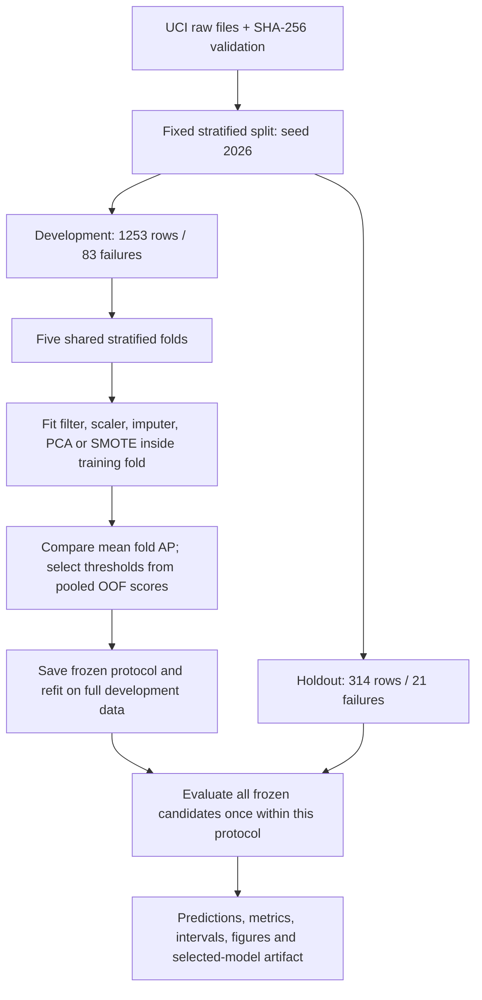

# Semiconductor Yield Anomaly Detection

A personal investigation of missing sensor measurements, rare failures, and decision thresholds on **UCI SECOM**.

I built this project around a deceptively simple problem: predicting every observation as a pass produces about **93.4% accuracy**, while detecting **none of the failures**. I wanted to understand which parts of a machine-learning pipeline actually improve failure detection, and how much confidence I could place in the result.

The investigation keeps my original route: **Median vs. KNN imputation -> PCA -> SMOTE -> weighted XGBoost -> threshold tradeoffs -> sensor interpretation**. The revised implementation adds controlled comparisons, fold-local preprocessing, a frozen evaluation boundary, and enough saved evidence to reconstruct the reported numbers.

**Start here:** [findings and impact](docs/14_findings_and_impact.md) | [executed notebook](main.ipynb) | [generated results](results/RESULTS.md) | [documentation map](docs/00_navigation.md)


**Takeaway:** the completed study separates ranking quality from the consequences of an alert rule. The frozen rule catches more failures than the default cutoff, but requires substantially more reviews. These are measured detection outcomes, not evidence of improved manufacturing yield.

## What The Experiment Found

The predefined selection rule chose **Random Forest + KNN + SMOTE** using mean development-fold average precision (AP). XGBoost remains part of the investigation; the code does not assume it must win.


**Takeaway:** RF/KNN/SMOTE leads the original development comparison at **0.2110 mean fold AP**, with **0.1128 fold SD**. Its holdout AP is **0.2727**, above the constant-score reference **0.0669**, but several RF variants have similar holdout AP. The left panel shows fold variation; the right shows conditional bootstrap intervals. Neither establishes a universally superior pipeline, so the holdout ordering does not replace the development selection.

| Selected pipeline: RF / KNN + SMOTE | Result |
|---|---:|
| Mean development-fold AP | 0.2110 |
| Development-fold AP standard deviation | 0.1128 |
| Holdout AP | 0.2727 |
| Constant-score holdout AP reference | 0.0669 |
| Precision at frozen OOF threshold | 0.1923 |
| Recall at frozen OOF threshold | 0.4762 |
| F1 at frozen OOF threshold | 0.2740 |
| Detected failures | 10 / 21 |
| False alarms | 42 / 293 passing observations |
| Reviews triggered | 52 / 314 observations |

At the default threshold **0.5**, this same fitted pipeline catches **1 of 21** failures with **1 review**, **0 false alarms**, and **F1 0.0909**. At the development-frozen threshold **0.242222**, it catches **10 of 21**, with **F1 0.2740**. That is **9 additional detected failures for 51 additional reviews**, including **42 false alarms**; **11 failures remain missed**. Both operating points use the same holdout scores, whose AP is unchanged. The counts are in [holdout_metrics.csv](results/holdout_metrics.csv).

These results show useful ranking signal, with considerable uncertainty and a substantial false-alarm burden. The selected pipeline's conditional 95% AP interval is **[0.1534, 0.4720]**; its failure-recall Wilson interval is **[0.2834, 0.6763]**. This is an offline diagnostic study, not evidence of factory readiness.

An important counterexample: Median + Random Forest obtained **0.3210 holdout F1**, above the selected pipeline's 0.2740. I retain the development-selected model rather than change the winner after seeing test results. The full comparison, including XGBoost and the chronological sensitivity check, is in the [generated report](results/RESULTS.md).

## Questions I Worked Through

| Question | Controlled comparison | What I can conclude |
|---|---|---|
| Does local imputation help? | The same balanced RF with Median or KNN | Original mean fold AP rises from 0.1848 to 0.2007; KNN trails Median in two of three supplementary repeats |
| Does retaining 90% variance retain failure signal? | RF / KNN with and without fold-fitted PCA90 | Mean fold AP falls from 0.2007 to 0.1626; retaining variance does not guarantee discrimination |
| Does oversampling help? | RF / KNN with and without training-only SMOTE | Original mean fold AP rises to 0.2110; the paired difference is also positive in all three supplementary repeats |
| Does a weighted boosting model improve ranking? | Fixed, regularized XGBoost against simple and RF baselines | XGBoost does not win the original selection; its supplementary rank changes with the repeat |
| What changes when I move the threshold? | Default 0.5 vs. development-OOF-selected threshold | Report recovered failures together with the extra alerts |
| Do results transfer forward in time? | Fixed XGBoost on an earlier/later development split | A separate sensitivity check; one random split is not a deployment simulation |

Zero F1 at threshold 0.5 does not prove that a model has no ranking signal. That distinction changed how I interpret my original PCA and SMOTE experiments.

## What I Built

I implemented source validation, fold-local pipelines, shared-fold comparisons, frozen threshold selection, metric reconstruction, and a saved-pipeline batch interface. The original comparison contains **7 candidates x 5 folds = 35 CV fits**. The supplementary check adds **4 candidates x 3 repeats x 5 folds = 60 CV fits**; these counts exclude full-development refits and the separate chronological check.

The data contain **1,567 observations, 104 failures, and 590 input sensors**. I reserved **1,253 development rows** and **314 holdout rows**, containing **83** and **21 failures**, respectively. The learned filter retains **446 sensors on full development data**; fold-specific masks are learned separately. The [case study](docs/14_findings_and_impact.md) connects these deliverables to raw tables and explains all eight original figures plus the two supplementary figures.

## Evaluation Design



**Takeaway:** the diagram places every learned transformation and selection decision on the development side of the evaluation boundary. Holdout results measure the already frozen choices. The seven candidates are a prevalence dummy, balanced logistic regression with Median imputation, RF/Median, RF/KNN, RF/KNN/PCA90, RF/KNN/SMOTE, and weighted XGBoost/KNN.

- **Preprocessing:** training-only missingness/constant-column filtering, then training-fitted standardization before imputation. This gives KNN distances a common scale. Evaluation data never fit a scaler or supply imputation donors.
- **PCA:** retain 90% training variance separately in each fit. No historical component count is hardcoded.
- **SMOTE:** create synthetic observations only within the training partition. Evaluation rows and their class prevalence remain unchanged.
- **Model choice:** maximum mean fold AP, with fixed candidate order breaking exact ties.
- **Threshold choice:** maximum pooled development OOF failure F1; exact count-based ties retain the highest threshold. No holdout labels participate.
- **Freeze:** write `protocol.json` before holdout scoring. The CV-selected winner remains selected even if the holdout ordering differs.
- **Uncertainty:** class-stratified fixed-score AP bootstrap and failure-recall Wilson intervals. Neither captures all training, model-selection, or future-drift uncertainty.

AP means `average_precision_score`, not trapezoidal precision-recall area. OOF threshold F1 is a development optimization result, not an independent performance estimate. Model scores are not presented as calibrated failure probabilities.


**Takeaway:** the selected model's frozen dot has **0.4762 recall** and **0.1923 precision**: it catches fewer than half the failures, and most alerts are false alarms. The curve explains why ranking above prevalence can coexist with a demanding review burden. Dots use thresholds selected on development OOF predictions; choosing a better-looking holdout point would invalidate that boundary. AP summarizes the ranking and does not calibrate scores as failure probabilities.

## Completed Development Diagnostics

I checked fold-assignment and estimator sensitivity using seeds **17, 43, and 89**, reusing only the original development rows. XGBoost ranks first among the four checked candidates at seed **17**; RF/KNN/SMOTE ranks first at **43 and 89**. SMOTE minus plain RF/KNN mean fold AP is **+0.0183, +0.0447, and +0.0433**, respectively. These descriptive repeats support a consistent observed SMOTE advantage over plain RF/KNN, while showing that the leading candidate changes.

I also translated the original OOF ranking into hypothetical review counts. For the selected pipeline, per-fold budgets of **5%, 10%, and 20%** produce **60, 125, and 250 reviews**, catching **15, 20, and 39 of 83 development failures**. At 10%, plain RF/KNN catches **29** versus SMOTE's **20** with the same **125 reviews**. An AP-selected model need not be the best model for a specific capacity constraint. These are post-hoc development diagnostics using hypothetical fold blocks, with no new holdout selection. See the [methods and chart interpretation](docs/13_development_diagnostics.md) and [generated supplement](supplementary/development/REPORT.md).

## Run It

Use **Python 3.12** and [uv](https://docs.astral.sh/uv/). The repository includes `uv.lock`; no GPU is required.

```bash
git clone https://github.com/Paul-Lai0111/semiconductor-yield-anomaly-detection.git
cd semiconductor-yield-anomaly-detection
uv sync --locked
uv run python main.py --overwrite
```

The first run downloads the original UCI archive into ignored `data/raw/` and verifies both raw-file hashes. The default study uses five development folds, 300 trees for the RF and XGBoost candidates, two CPU threads, and 2,000 bootstrap resamples. Its first execution can take several minutes, including plotting/font initialization.

Published results are already included, so `--overwrite` explicitly replaces that run. To execute the notebook and quality checks afterward:

```bash
uv run python scripts/execute_notebook.py
uv run pytest
uv run ruff check .
```

For a separate integration run with a smaller compute budget:

```bash
uv run python main.py --trees 30 --folds 2 --bootstrap 50 --skip-temporal --output artifacts/smoke
```

Custom runs keep their metrics, figures, and model under their own output directory. They do not replace the published figures or selected model. An existing nonempty run directory is protected unless `--overwrite` is supplied. A reduced run is a code check, not a reproduction of the published five-fold study.

`requirements.txt` is an exact runtime export for pip users. Development checks and notebook execution use the locked uv development environment. See `python main.py --help` for all options.

To reproduce the supplementary development diagnostics in the same environment:

```bash
uv run python -m scripts.development_diagnostics --overwrite
uv run python -m scripts.visual_summary
```

The command validates the original evidence and uses cached UCI data, downloading and hash-checking the source if needed. It writes to `supplementary/development/`; `--overwrite` replaces the existing supplement. No additional installation is required. The original model selection, thresholds, holdout results, and eight figures remain the frozen study evidence.

## Inspect The Evidence

| File | Why I save it |
|---|---|
| [results/RESULTS.md](results/RESULTS.md) | Readable comparison, uncertainty, and chronological sensitivity |
| [results/protocol.json](results/protocol.json) | Configuration, candidate parameters, frozen model choice and thresholds |
| [results/split_manifest.csv](results/split_manifest.csv) | Original row identity, partition, timestamps, class labels and validation folds |
| [results/fold_metrics.csv](results/fold_metrics.csv) | Per-fold AP, support, retained sensors, PCA dimensions and runtime |
| [results/oof_predictions.csv](results/oof_predictions.csv) | Reconstruct development comparisons and threshold selection |
| [results/holdout_predictions.csv](results/holdout_predictions.csv) | Reconstruct final scores, confusion counts and operating-point metrics |
| [results/metrics.json](results/metrics.json) | Structured results, conditional intervals, environment and source hashes |
| [results/feature_importance.csv](results/feature_importance.csv) | XGBoost's development-trained gain ranking with original sensor IDs |
| [supplementary/development/repeat_metrics.csv](supplementary/development/repeat_metrics.csv) | Descriptive ranks, AP and thresholds across three development repeats |
| [supplementary/development/capacity_summary.csv](supplementary/development/capacity_summary.csv) | Review counts, detected failures and false alarms under hypothetical budgets |
| [supplementary/development/provenance.json](supplementary/development/provenance.json) | Supplementary configuration, input hashes and separate source hashes |

The notebook reads the original study artifacts, checks the split/selection boundaries, independently reconstructs metrics from predictions, and displays selected original figures. The case study explains all eight original figures; the supplementary report documents the additional checks separately. The notebook does not silently train a different experiment or optimize a new threshold on the holdout.

## Use The Saved Pipeline

After running the study, `artifacts/selected_model.joblib` contains the full-development refit, its frozen threshold, original sensor schema, configuration, and protocol hash. It is generated locally rather than committed.

```bash
uv run python -m scripts.predict --model artifacts/selected_model.joblib --protocol results/protocol.json --input measurements.csv --output artifacts/predictions.csv
```

The output CSV contains `row_id` (zero-based input position), `score`, and binary `alert`, where `alert = score >= frozen threshold`. `artifacts/predictions.metadata.json` records the candidate, threshold, row count, and hashes of the input, model bundle, protocol, frozen study source, and prediction script. The command verifies the bundle against the protocol and source, then scores without fitting or retuning. Existing prediction files require `--overwrite`.

Inputs must contain exactly the **590** sensor names `sensor_000` through `sensor_589`, with the original definitions and units; header order may vary. Blank cells are accepted as missing. Invalid values, duplicate or mismatched headers, and rows with every retained sensor missing are rejected. Scores are uncalibrated model outputs. Use the locally generated study bundle; this interface demonstrates reproducible inference without establishing a production monitoring service.

The batch and supplementary scripts are additions outside the original experiment's source-hash set. Their own hashes document the added functionality; they do not redefine the source or evidence of the frozen run.

## What Changed From My First Version

The first version searched a precision-recall curve on the test set and reported the best threshold on that same set. It also filtered sensors before splitting, fit a separate test scaler in the Median branch, and used unscaled KNN distances. Those choices weakened the comparison.

This revision keeps the investigation but changes the evidence standard. I removed the unsupported blanket claim that KNN improves on Median by 50%, stopped treating PCA/SMOTE failure mechanisms as established facts, and made XGBoost earn its comparison rather than naming it the final winner in advance. The old threshold 0.0159 and F1 0.36 are historical exploratory results; comparing them directly with the revised holdout F1 would conflate several protocol changes.

The code is now split into data validation, pipeline definitions, evaluation, experiment orchestration, and reporting. Regression tests cover leakage boundaries, standardized KNN geometry, training-only SMOTE, class weights, exact F1 ties, data corruption, output isolation, serialization, and report consistency. GitHub Actions runs the locked lint/test checks.

## Project Map

```text
main.py                    CLI entry point
main.ipynb                 Executed investigation and artifact checks
secom/data.py              UCI download, checksum and schema validation
secom/modeling.py          Training-only preprocessing and seven candidates
secom/evaluation.py        Metrics, exact threshold policy and intervals
secom/experiment.py        Shared folds, freeze, refits and temporal check
secom/reporting.py         Figures and generated results
scripts/predict.py          Validated batch scoring and metadata export
scripts/development_diagnostics.py  Post-hoc development checks
scripts/visual_summary.py   Closing visual generated from recorded measurements
tests/                     Statistical-boundary and orchestration regressions
docs/                      Navigation and fourteen diagnostic/case-study chapters
results/                   Committed protocol, predictions and measurements
images/                    Eight original figures and one closing findings summary
supplementary/development/  Repeat/capacity evidence and one additional figure
```

## Data Attribution

Michael McCann and Adrian Johnston (2008), **SECOM**, UCI Machine Learning Repository. [DOI: 10.24432/C54305](https://doi.org/10.24432/C54305). Dataset license: **CC BY 4.0**.

The raw feature file contains 590 numeric sensor columns; timestamps are supplied with the labels and are kept outside the predictor matrix. See [data/README.md](data/README.md) for integrity hashes and source handling.

## Conclusion

1. **There is measurable ranking signal.** The originally selected RF/KNN/SMOTE pipeline has holdout AP **0.2727** versus **0.0669** for a constant score; closely performing alternatives and changing repeat ranks limit claims of model superiority.
2. **The operating rule changes the workload.** Moving from 0.5 to the development-frozen threshold changes detection from **1 to 10 of 21 failures**, with **52 reviews**, **42 false alarms**, and **11 misses** at the frozen rule.
3. **The objective matters.** SMOTE beats plain RF/KNN on mean fold AP in all three supplementary repeats, yet plain RF/KNN catches **29 versus 20** development failures at the same **125-review** capacity. Ranking, threshold F1, and capacity-constrained detection answer different questions.

This is an offline supervised study of a previously explored public dataset. The holdout has only 21 failures; one catch changes recall by about 4.8 percentage points, and the reported intervals are conditional. Random folds do not establish independence across lots or tools, repeated development checks are descriptive, and the fixed-XGBoost chronological check does not validate every candidate's transfer. Anonymous sensors, uncalibrated scores, unknown costs, and hypothetical review blocks limit engineering interpretation. The completed contribution is auditable detection evidence and a reproducible scoring interface; manufacturing yield improvement, prevented losses, and factory reliability were not measured.
