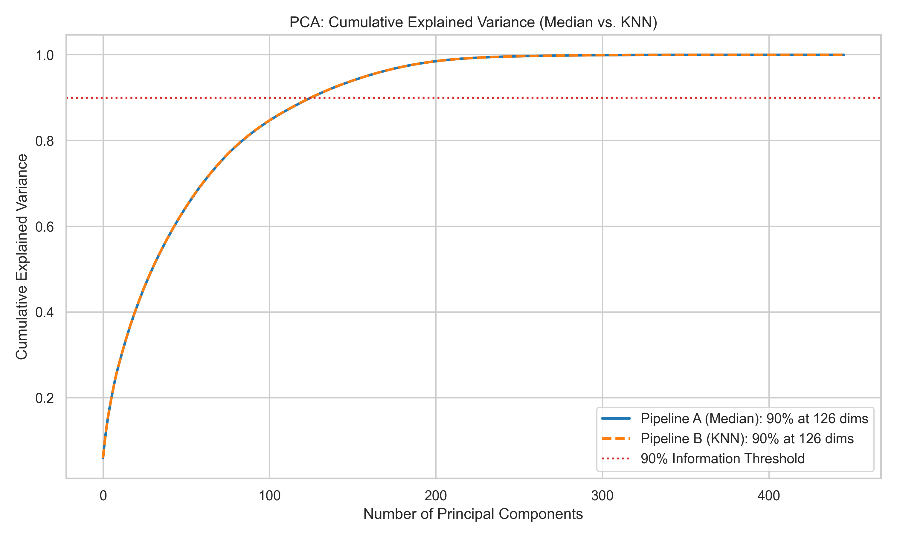
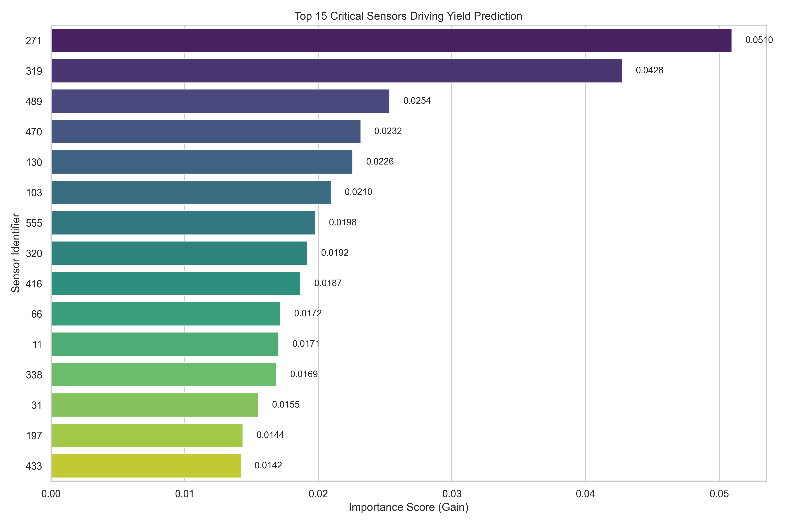

# Semiconductor Yield Anomaly Detection  
## A Diagnostic Machine Learning Pipeline for Industrial Defect Interception

---

# 1. Project Overview

In semiconductor manufacturing, yield is directly tied to profitability.  
A small fraction of defective wafers can cause disproportionately large financial damage.

This project builds a **defect interception system** using the UCI SECOM dataset.

However, this is not a standard classification problem.

It presents two structural challenges:

| Structural Challenge | Description |
|----------------------|------------|
| Extreme Class Imbalance | Defects represent a small minority of production |
| High-Dimensional Noise | 590 raw sensor channels with missingness and redundancy |

This repository documents a **step-by-step diagnostic investigation**, not just a final model.

We answer:

- Why do PCA and SMOTE fail?
- Why does imbalance suppress probabilities?
- Why does default threshold collapse detection?
- Why is threshold tuning central?
- Why is cost-sensitive XGBoost the final design?

---

# 2. Dataset Overview

## Basic Statistics

| Metric | Value |
|--------|-------|
| Total wafers | 1,567 |
| Raw sensors | 590 |
| Final sensors after cleaning | 446 |
| Label encoding | -1 → 0 (Pass), 1 → 1 (Fail) |

---

## A Glimpse into the Raw Data

| Index | Sensor_0 | Sensor_1 | ... | Sensor_5 | ... | Sensor_585 | Sensor_589 | Label (Raw) | Target (Mapped) |
| :--- | :--- | :--- | :--- | :--- | :--- | :--- | :--- | :--- | :--- |
| **0** | 3030.93 | 2564.00 | ... | 100.0 | ... | 2.3630 | NaN | -1 | **0** |
| **1** | 3095.78 | 2465.14 | ... | 100.0 | ... | 4.4447 | 208.2045 | -1 | **0** |
| **2** | 2932.61 | 2559.94 | ... | 100.0 | ... | 3.1745 | 82.8602 | 1 | **1** |
| ... | ... | ... | ... | ... | ... | ... | ... | ... | ... |

> Labels were remapped for binary classification.

Observation:

- Some sensors are constant (e.g., 100.0)
- Missing values appear in many columns
- Sensor scales differ drastically

These characteristics directly influence preprocessing decisions.

---

# 3. Data Cleansing Strategy

## Removing High-Missing Sensors (>50%)

Why?

Imputing sensors with extreme sparsity fabricates most of their values.  
The model risks learning imputation assumptions instead of physical behavior.

## Removing Zero-Variance Sensors

Constant sensors contain zero entropy and no discriminative power.

---

## Resulting Feature Space

| Stage | Sensor Count |
|-------|--------------|
| Raw | 590 |
| After Cleaning | **446** |

This reduces dimensional noise and stabilizes geometry.

---

# 4. PCA Diagnostic: Understanding Variance Structure

We applied PCA to analyze variance compression.



### Observations

- Both Median and KNN pipelines require **129 components** to reach 90% variance.
- Variance is distributed across many dimensions.
- The space is not trivially low-rank.

### Interpretation

PCA does not significantly reduce dimensionality without losing structure.  
This suggests:

- Sensor space is intrinsically complex.
- Dimensional compression alone is unlikely to solve class separability.

---

# 5. PCA as Dimensionality Reduction (Failure Case)

After reducing to 129 components:

| Metric | Defect Class |
|--------|--------------|
| Precision | 0.00 |
| Recall | 0.00 |
| F1 | 0.00 |

### Why It Failed

- PCA maximizes variance, not minority separability.
- Majority class dominates variance structure.
- Rare defect signals may lie in low-variance directions.

Conclusion:

Variance preservation ≠ anomaly separability.

---

# 6. SMOTE Oversampling (Failure Case)

SMOTE was applied to balance training distribution.

Result:

| Metric | Defect Class |
|--------|--------------|
| Precision | 0.00 |
| Recall | 0.00 |
| F1 | 0.00 |

### Why It Failed

- High-dimensional overlap
- Synthetic samples blur boundaries
- Test distribution remains imbalanced
- Probability suppression persists

Conclusion:

Balancing the training distribution alone does not fix decision collapse.

---

# 7. Core Discovery: Probability Suppression

Inspection of predicted probabilities revealed:

Top defect probabilities ranged roughly between:

```
0.35 – 0.52
```

Meaning:

- The model ranks risk.
- But probabilities are compressed.
- Default threshold 0.5 eliminates most defect predictions.

This is not a model failure.  
It is an operating point mismatch.

---

# 8. Random Forest Threshold Tuning (Diagnostic Track)

Lowering threshold to **0.15**:

| Metric | Value |
|--------|-------|
| Defect Precision | 0.10 |
| Defect Recall | 0.86 |
| Defect F1 | 0.18 |
| Accuracy | 0.46 |

Interpretation:

- High defect interception
- Extremely high false alarm rate
- Operationally unstable

This confirms that threshold is a first-class system parameter.

---

# 9. Final Model: Cost-Sensitive XGBoost

## Precision-Recall Curve


### Observations

- Clear trade-off between recall and precision.
- Optimal F1 occurs at a very low threshold (~0.0159).
- PR-AUC significantly above random baseline.

---

## Final Optimized Result

| Metric | Value |
|--------|-------|
| Best Threshold | 0.0159 |
| Defect Precision | 0.26 |
| Defect Recall | 0.57 |
| Defect F1 | 0.36 |
| Accuracy | 0.86 |

---

## Model Comparison

| Model | Precision | Recall | F1 |
|--------|----------|--------|----|
| RF @ 0.15 | 0.10 | 0.86 | 0.18 |
| XGB @ 0.0159 | 0.26 | 0.57 | 0.36 |

XGBoost provides:

- Better precision-recall balance
- Reduced false alarm burden
- Stable operating point

---

# 10. Feature Importance



### Observations

- A small subset of sensors drives predictive signal.
- Influence is highly concentrated in top 15 sensors.

### Engineering Interpretation

This enables:

- Sensor watchlist creation
- Drift monitoring
- Preventive maintenance prioritization

Important:

Feature importance reflects predictive utility, not physical causality.

---

# 11. Is the Model Good?

Strengths:

- Breaks zero-detection collapse
- Demonstrates correct system reasoning
- Produces meaningful risk ranking

Limitations:

- No cross-validation stability
- No cost-matrix threshold optimization
- No probability calibration
- No drift monitoring

This is a **functional early-warning prototype**, not a final production system.

---

# 12. Repository Philosophy

This project demonstrates:

1. Why standard ML fixes fail under imbalance
2. Why variance-based reduction can erase minority signal
3. Why oversampling is insufficient alone
4. Why threshold is a system-level decision
5. Why cost-sensitive boosting is appropriate for industrial anomaly detection

It documents reasoning, not just results.

---

# Documentation

Full diagnostic breakdown available in `/docs`.

```
docs/00_navigation.md
```

Each chapter explains:

- Why this step?
- What breaks if skipped?
- What algorithmic logic applies?
- What evidence justified the next decision?

---

# Final Statement

This repository designs a defect interception system under:

- severe imbalance
- high-dimensional sensor noise
- asymmetric business cost
- suppressed probability outputs

The final solution — cost-sensitive XGBoost with optimized threshold selection — reflects a statistically grounded and operationally realistic approach.