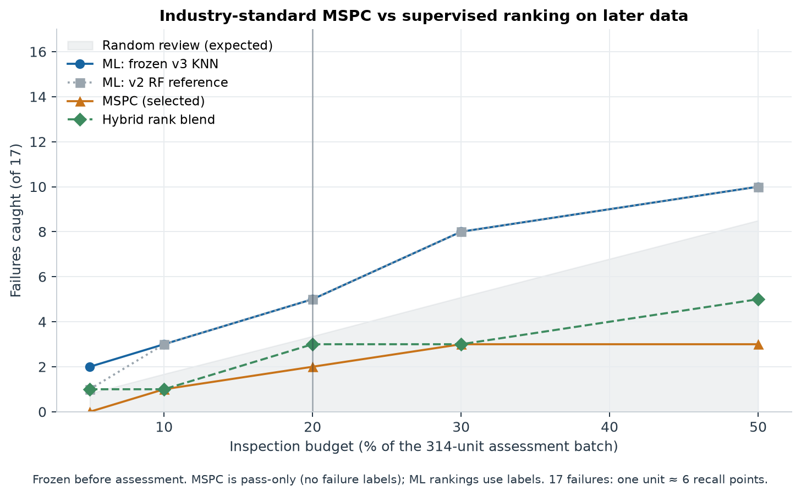
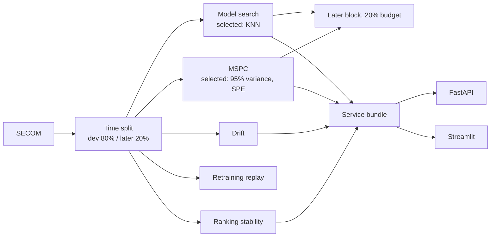
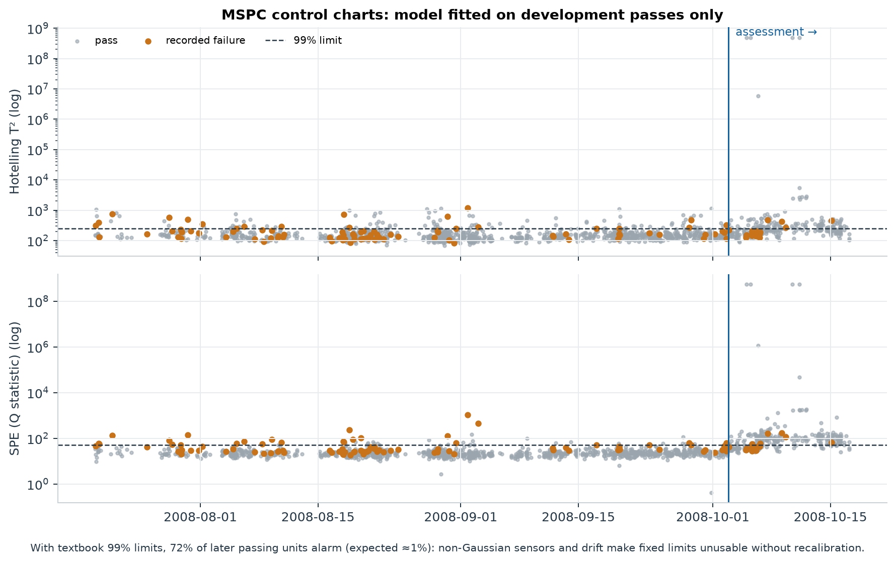
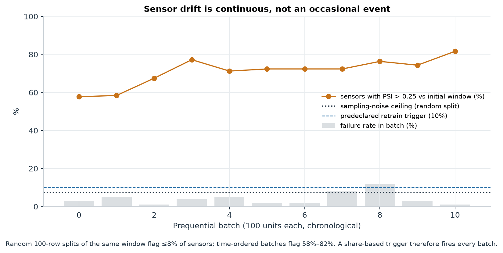
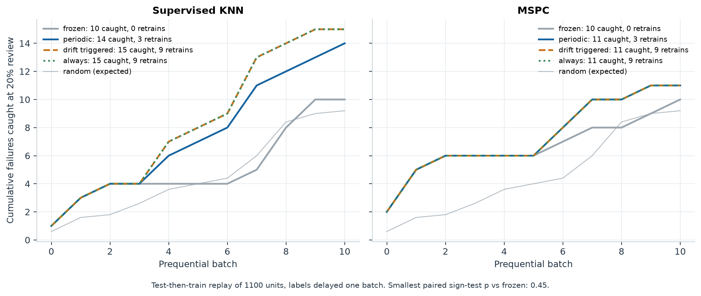

# Semiconductor Failure Detection for Smart Manufacturing

If a fab can only inspect 20% of a batch, which units should it pick, and how do you keep that choice working as the process drifts?

[Live monitor](https://semiconductor-yield-anomaly-detection-paullai.streamlit.app/) · Paul Lai, M.S. in Data Science, UC San Diego · [holai@ucsd.edu](mailto:holai@ucsd.edu)

This project uses the UCI SECOM dataset (1,567 units, 590 anonymised sensors, 104 failures). It covers:

- a chronological model search over 50 detector configurations;
- a comparison with MSPC (PCA with Hotelling T² and SPE), the usual fault-detection baseline in fabs;
- drift monitoring and a replay of retraining policies with delayed labels;
- a check of how stable the "important sensor" rankings are;
- a FastAPI scoring service, a Docker image and a Streamlit monitor.

The full write-up is the [engineering report](docs/16_engineering_report.md). Detailed numbers are in [fab_monitoring_results/RESULTS.md](fab_monitoring_results/RESULTS.md) and [manufacturing_results/RESULTS.md](manufacturing_results/RESULTS.md).



## Summary of results

| Question | Result |
|---|---|
| Does a larger model search beat the earlier recipe on later data? | No. The selected KNN catches 5 of 17 later failures in 62 reviews, the same as the earlier random-forest recipe. |
| Does the supervised ranking beat MSPC? | Yes, at every budget tested: 5 vs 2 failures at 20%, 10 vs 3 at 50%. With standard 99% limits, MSPC alarms on 72% of later passing units. |
| Is the process stable? | No. 58–82% of sensors drift (PSI > 0.25) in every 100-unit batch. Random splits of the same data flag at most 7.5%. |
| Does retraining help? | Probably, but it is not significant. Frozen model 10 / 46, periodic retraining 14 / 46, retraining every batch 15 / 46; sign test p ≥ 0.45. |
| Can we name the sensors that matter? | Not reliably. Top-20 overlap is about 0.2 across bootstraps and about 0.01 across time slices. Only `sensor_059` is consistently stable. |

My recommendation would be a shadow-mode pilot. The supervised ranking orders the inspection queue, MSPC contribution plots help with diagnosis, and the model is retrained on a schedule. Fixed MSPC limits should not be used as the alarm rule on this process.

## Setup

Predicting "pass" for every unit gives 93.4% accuracy and catches nothing, so I don't use accuracy. Each method is scored by how many failures it catches when exactly `floor(20% × batch)` units are reviewed.

The data is split by time. All model choices were made on the earliest 80% (1,253 units, 87 failures). The latest 20% (314 units, 17 failures) was scored once, after everything was fixed.

SECOM has no lot, tool or wafer IDs, and it doesn't say when each sensor is read. So I can't check whether every sensor would be available at decision time, or whether inspecting a flagged unit would prevent anything. Those would need to be confirmed before real use.



| Package | Contents |
|---|---|
| [`secom/`](secom/) | Data download and checksum, plus the earlier random-split study |
| [`smartfab/`](smartfab/) | Chronological model search, review policies, batch scoring CLI |
| [`fabops/mspc.py`](fabops/mspc.py) | PCA monitoring model, T² and SPE limits, per-sensor contributions |
| [`fabops/drift.py`](fabops/drift.py) | PSI (with a missing-value bin), KS with Benjamini-Hochberg, missing-rate change |
| [`fabops/retraining.py`](fabops/retraining.py) | Test-then-train replay of four retraining policies with label delay |
| [`fabops/stability.py`](fabops/stability.py) | Sensor rankings (ANOVA, random forest, MSPC) over bootstraps and time slices |
| [`fabops/service.py`](fabops/service.py), [`fabops/api.py`](fabops/api.py) | Model bundle, input validation, inspection queue, API |
| [`dashboard/app.py`](dashboard/app.py) | Streamlit monitor |

## MSPC baseline

The PCA model is fitted on passing development units only, using median imputation and z-scoring. The T² limit uses the F distribution, and the SPE limit uses Box's g·χ²(h) approximation. Per-sensor contributions add up exactly to T² and SPE, and a unit test checks this. I tried nine variants (80/90/95% variance × T² / SPE / both) and chose one on development data, with the same objective as the model search.

| Later block, 62 reviews | Failures caught / 17 | Passing units flagged | Average precision |
|---|---:|---:|---:|
| Supervised ranking (KNN) | 5 | 57 | 0.068 |
| MSPC (`mspc_var95_spe`) | 2 | 60 | 0.041 |
| Rank blend of the two | 3 | 59 | 0.053 |
| Random review, expected | 3.36 | – | – |



SPE crosses its limit almost exactly where the later block starts, so MSPC mostly picks up that the process has shifted. The two methods also catch different failures: 4 caught only by KNN, 1 only by MSPC, and 1 by both. I kept MSPC in the monitor for its contribution plots and alarm Pareto, which are useful for finding where to look.


## Drift



PSI uses 10 quantile bins from the reference window plus one bin for missing values, so a sensor that starts dropping readings also counts as drift. On small batches PSI is noisy even without drift: about (bins − 1)·(1/n + 1/m), roughly 0.1 for 100 rows. To get a fair threshold, I measured this directly. Random 100-row splits of one window flag at most 7.5% of sensors, while the last 100 rows of the same window, taken in time order, flag 51%.

The drift is continuous rather than a few sudden jumps. Because of that, a drift trigger based on the original training window fires on every batch, so it can't be used to decide when to retrain.

## Retraining



The replay runs over 1,100 units in batches of 100. Each batch is scored before its labels are used, labels arrive one batch late, and every retrain uses all labelled data available at that point.

Without retraining, the model is close to random (10 caught vs 9.2 expected). Retraining raises this to 14–15. Periodic retraining gets most of the gain with a third of the retrains. With only 46 failures, the difference is not statistically significant.

## Sensor rankings


With 87 failures, one feature-importance run is not reliable. The top 20 changes a lot between bootstrap samples (Jaccard about 0.2), almost completely between time periods (about 0.01), and the three ranking methods rarely agree (≤ 0.05). So the monitor shows a watchlist grouped by stability: 1 stable sensor and 17 moderately stable ones. It is a list of where to check first. Because the sensors are anonymised, it can't identify root causes.

## Live monitor

The [live monitor](https://semiconductor-yield-anomaly-detection-paullai.streamlit.app/) replays the 314-unit later block, where the outcomes are known. After a period of inactivity, the first load takes about a minute while the models are rebuilt.

- The batch is drawn as a wafer bin map, one cell per unit in time order. SECOM has no die positions, so cell position shows time order, not location on a wafer.
- Click a cell to see its rank, its T² and SPE against the 99% limits, and the sensors that contribute most to its SPE.
- In the sidebar you can change the review budget (5–50%), the ranking (KNN, MSPC SPE or the blend), and whether recorded outcomes are shown.
- The tabs show the queue (downloadable as CSV), the alarm Pareto, the control charts, drift, detection vs budget, and the sensor watchlist.
- You can upload your own CSV with columns `sensor_000` … `sensor_589` and an optional integer `unit_id`. The page links a 20-unit sample file. Outcomes are never read from uploads.

| Cell | Meaning |
|---|---|
| Red, filled | Failure inside the queue (caught) |
| Red, outlined | Failure outside the queue (missed) |
| Dark | Passing unit inside the queue (false alarm) |
| Pale | Not queued |

## Running the service

```bash
uv sync --locked
uv pip install -r requirements-service.txt
uv run python -m fabops.service build      # fit the selected models on the development window
uv run uvicorn fabops.api:app --port 8000  # docs at http://localhost:8000/docs
uv run streamlit run dashboard/app.py
```

| Endpoint | Purpose |
|---|---|
| `GET /health`, `GET /model` | Health check; model versions, control limits and watchlist |
| `POST /score?policy=v3_selected_knn&review_fraction=0.2` | Score JSON records and return the ranked queue with T²/SPE alarms |
| `POST /score/csv` | Same, for a CSV upload |
| `POST /drift` | Per-sensor drift against the training window |

The API rejects input with missing or extra sensor columns, duplicate or non-integer IDs, non-numeric values, infinities or fully empty rows. Ties are broken by a hash of `unit_id`, so the result doesn't depend on row order.

```bash
docker build -t fab-monitor .
docker run --rm -p 8000:8000 fab-monitor
docker compose up   # API on :8000, dashboard on :8501
```

## Model search

The search compared 50 fixed configurations: forests, boosting, SVMs, linear and discriminant models, nearest neighbours, and novelty detectors trained on passing units only. It also included a blend of the top two, which I defined before running the search. Each candidate was evaluated on three expanding forward blocks within the development period. Candidates were ranked by failures caught at 20% review, with average precision as the tie-break. The protocol was saved before the search, and the selected model was saved before the later block was scored.

| Later block (314 units, 17 failures) | Selected KNN | Earlier recipe, refitted |
|---|---:|---:|
| Failures caught in 62 reviews | 5 | 5 |
| Review precision | 8.1% | 8.1% |
| Average precision | 0.068 | 0.077 |

Random review of 62 units would catch 3.36 failures on average (95% range 1–7). The larger search did not beat the earlier recipe. See the [protocol](docs/15_smart_manufacturing_protocol.md) and the [executed notebook](manufacturing_notebook.ipynb).

## Reproduce

Python 3.12, CPU only, about 10 minutes.

```bash
git clone https://github.com/Paul-Lai0111/semiconductor-yield-anomaly-detection.git
cd semiconductor-yield-anomaly-detection
uv sync --locked
uv pip install -r requirements-service.txt
uv run python -m smartfab.study --overwrite   # model search + later-block assessment (~4 min)
uv run python -m fabops.study --overwrite     # MSPC, drift, retraining, stability (~5 min)
uv run pytest
```

The loader checks the UCI files against their SHA-256 hashes and caches them in `data/raw/`. Re-running the search from scratch gives the same selected model and the same decisions on the later block. The earlier random-split study runs with `uv run python main.py --overwrite` (output in `results/`, notebook `main.ipynb`).

## Limitations

- SECOM is a public dataset that has been studied many times, so this is not external validation.
- With 17 failures in the later block and 46 in the replay, differences of a few units are within noise.
- Sensors are anonymised, so rankings and contributions only say where to check first, not what is physically wrong.
- I did not measure prevented defects, yield, throughput or cost savings. The cost scenarios in `manufacturing_results/` are based on assumed costs.

## Data

Michael McCann and Adrian Johnston (2008), SECOM, UCI Machine Learning Repository. [DOI: 10.24432/C54305](https://doi.org/10.24432/C54305). License: CC BY 4.0. Download and checksum details are in [data/README.md](data/README.md).
