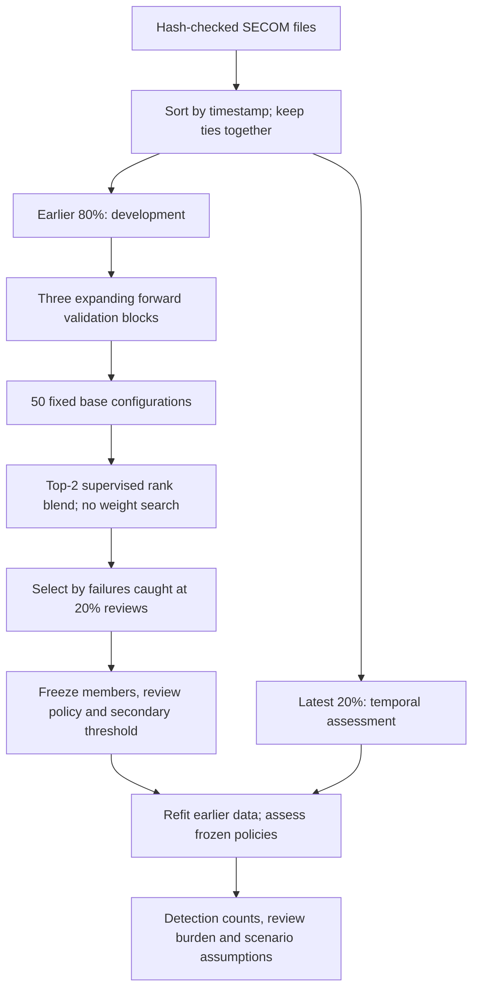

# Semiconductor Failure Detection for Smart Manufacturing

**A reproducible search for failures under limited inspection capacity, with chronological validation and explicit production assumptions.**

I used UCI SECOM to investigate a manufacturing question: **if only 20% of a batch can be reviewed, which method flags the most recorded failures?** I compared 50 fixed base configurations and a predeclared rank blend, covering forests, boosting, SVMs, linear/discriminant methods, nearest neighbors, and pass-only novelty detectors. Every method used the same forward development windows before the selected recipe was frozen and assessed on later observations.

**The result is qualified:** the development-selected method flagged **5 of 17** later failures with **62 reviews**, matching the previous recipe at the same budget. A larger search did not establish a temporal detection improvement. The project makes that outcome inspectable rather than selecting a different winner after viewing the assessment.

[Executed manufacturing notebook](manufacturing_notebook.ipynb) | [Full results](manufacturing_results/RESULTS.md) | [Exact protocol](docs/15_smart_manufacturing_protocol.md) | [Model catalog](manufacturing_results/protocol.json)


## The Production Question

SECOM has **1,567 observations, 590 anonymized sensor columns, and 104 failures**. Predicting pass for everything achieves about 93.4% accuracy while flagging no failures. I therefore evaluate detection together with review workload, rather than optimizing accuracy alone.

The target is the supplied pass/fail outcome, so this is **supervised failure classification** with two pass-only novelty references. It is not image defect segmentation, physical fault diagnosis, or proof of detecting unseen failure modes. Production entities are the unit of analysis; the data do not identify their physical product type, lot, or tool.

The concrete application is **inspection prioritization**: rank a completed batch and allocate a fixed number of reviews. More correctly flagged failures can be useful only if the measurements are available at the right decision time and an effective intervention exists. The dataset does not verify those conditions or supply observed production throughput, inspection times, or intervention outcomes.

## What I Built

| Completed work | Inspectable output |
|---|---|
| Bounded model search | 50 base configurations, 150 forward fits, one development-derived rank blend |
| Temporal evaluation | 1,253 earlier development rows / 87 failures; 314 later assessment rows / 17 failures |
| Model-independent decision objective | Highest forward failures caught at an exact per-block 20% review budget; AP and fixed order break ties |
| Missing-data alternatives | Training-local pruning, missing indicators, robust scaling, ANOVA selection, median or native-NaN pipelines |
| Honest novelty references | Isolation Forest and One-Class SVM learn preprocessing and models from training passes only |
| Frozen deployment recipe | Selected pipeline, schema, review policy, secondary threshold, protocol and source hashes |
| Workload and production scenarios | Five review budgets, confusion counts, random-review comparisons, and explicit hypothetical cost grids |
| Visual evidence | Six figures with takeaways, an executed notebook, row-level scores, tests and GitHub Actions |

The older Median/KNN/PCA/SMOTE investigation remains available as [v2 historical evidence](docs/14_findings_and_impact.md). Its random-split results are not directly comparable with the latest-time assessment below.

## How The Search Was Selected



- The three development validation blocks contain **8, 9 and 11 failures**, respectively. The first 40% of development observations trains the first model; training expands to 60% and 80% for the following blocks.
- Every learned transformation is fitted only on that block's training observations. Timestamps define boundaries and are excluded from predictors.
- The primary policy reviews exactly `floor(0.20 * block_rows)` highest scores. SHA-256 ordering of stable row IDs breaks score ties without labels.
- The winner has the highest total forward true positives; higher mean block AP and fixed catalog order break exact ties. Runtime does not determine selection.
- A predeclared blend averages unnormalized average ranks of the two leading supervised candidates before one final normalization. It has no fitted blending weights.
- Five-fold development OOF predictions for the top three supervised candidates supply a **secondary** F2 threshold, with at most 20% OOF alerts. This diagnostic does not override the temporal selection and cannot guarantee future capacity.
- The recipe is frozen before scoring the latest block. Candidate, budget, threshold and blend membership are not reselected from those assessment results.

The complete configuration and source hashes were saved **before search** in [protocol.json](manufacturing_results/protocol.json). The chosen recipe and threshold were saved **before assessment** in [selection.json](manufacturing_results/selection.json). SECOM was previously explored: this is a protected within-run time boundary, not historically unseen or external validation.

## Findings And Takeaways

### 1. Broader model choice did not establish better temporal detection

The fixed rule selected **`knn_k100_neighbors5`**: robust-scaled, ANOVA-selected features and a distance-weighted five-neighbor classifier. This KNN classifier is distinct from the older KNN imputer used before a Random Forest.

It flags **12 of 28 forward-validation failures** at the chosen capacity, versus **11 of 28** for the v2 recipe. That one-failure development advantage does not transfer to a better assessment catch count.


**Takeaway:** the chosen candidate satisfies the predefined search objective, but is not a proven globally best or state-of-the-art detector. Shared development blocks, 50 comparisons and few failures make selected development scores optimistic.

### 2. Quantify detection together with false alerts

| Latest temporal assessment | Selected method | v2 recipe refitted on the same earlier data |
|---|---:|---:|
| Reviewed observations | 62 / 314 | 62 / 314 |
| Failures flagged | 5 / 17 | 5 / 17 |
| Missed failures | 12 | 12 |
| Passing observations flagged | 57 | 57 |
| Recall | 29.4% | 29.4% |
| Review precision | 8.1% | 8.1% |
| Average precision | 0.068 | 0.077 |

Randomly reviewing 62 of these 314 observations would catch **3.36 failures in expectation**, with a 95% hypergeometric catch range of **1-7**. The selected method catches five, but that difference alone is not proof of reliable superiority over random review. Its conditional AP interval is **[0.052, 0.146]**; recall's Wilson interval is **[0.133, 0.531]**.

**Takeaway:** there is a measurable allocation outcome, but this run does not establish a strong detector or a detection improvement over the previous recipe. The false-alert burden remains substantial.

### 3. Higher recall consumes more reviews


| Selected ranking: review budget | Reviews | Failures flagged / 17 | Passing observations flagged |
|---|---:|---:|---:|
| 5% | 15 | 2 | 13 |
| 10% | 31 | 3 | 28 |
| **20% primary policy** | **62** | **5** | **57** |
| 30% | 94 | 8 | 86 |
| 50% | 157 | 10 | 147 |

**Takeaway:** a larger review budget increases the observed catch count, but even reviewing half this batch misses seven failures. These are descriptive operating scenarios on a frozen ranking, not a new winner selection or evidence of increased factory capacity.

### 4. Make temporal and production assumptions visible


The time plot shows changing label composition and the assessment cutoff. It does not establish the physical cause of that change, sensor drift, or a prediction lead time. A random split can mix these periods; the temporal assessment asks the harder question of transfer to later observations.


The cost model is `reviews + (failures - effectiveness * caught) * escape_cost + false_alerts * hold_cost`. Review cost is normalized to one; escape cost, passing-item hold cost, and intervention effectiveness are assumptions. The report includes no additional review, full review, random review, and model policies, including scenarios where no additional review is cheaper.

**Takeaway:** the project can expose the conditions under which prioritization might be useful. It has not measured prevented defects, financial savings, production throughput, or yield improvement.

## Reproduce The Study

Use Python 3.12 and the committed uv lockfile. CPU execution is sufficient; no additional model packages or GPU are required.

```bash
git clone https://github.com/Paul-Lai0111/semiconductor-yield-anomaly-detection.git
cd semiconductor-yield-anomaly-detection
uv sync --locked
uv run python -m smartfab.study --overwrite
uv run python scripts/build_manufacturing_notebook.py
uv run pytest
uv run ruff check .
uv run ruff check --isolated --select E,F,I,B,UP --ignore E501 --target-version py312 smartfab
```

The study verifies the original UCI file hashes and caches raw inputs in ignored `data/raw/`. `manufacturing_results/` already contains the published run, so replacement requires `--overwrite`. The default uses two CPU threads. All candidates completed this run without recorded fit warnings; [fit_notes.json](manufacturing_results/fit_notes.json) is retained for inspection.

The legacy v2 experiment remains reproducible with `uv run python main.py --overwrite`; its reports are under `results/`, and its executed notebook is `main.ipynb`.

## Batch Scoring

After reproducing the study, score an unlabeled completed batch:

```bash
uv run python -m smartfab.predict \
  --model manufacturing_results/artifacts/selected_model.joblib \
  --protocol manufacturing_results/protocol.json \
  --selection manufacturing_results/selection.json \
  --input measurements.csv \
  --output artifacts/manufacturing_predictions.csv
```

The CSV must contain the original 590 sensor columns. An optional unique integer `unit_id` preserves score ties across row-order changes; otherwise batch positions are used. Blank sensor cells are missing. Duplicate/mismatched columns, invalid numeric text, infinities, NUL bytes, and rows with no observed retained sensor are rejected.

Outputs are `unit_id`, uncalibrated `score`, primary capacity-constrained `review`, and secondary `threshold_alert`. Metadata records actual model/input/protocol/selection/source hashes and the decision rules. The primary policy applies to a **completed batch**; the fixed threshold has no future alert-rate guarantee. Only load trusted study-generated joblib bundles.

## Evidence Map

| Artifact | What it verifies |
|---|---|
| [RESULTS.md](manufacturing_results/RESULTS.md) | Complete findings, uncertainty, six figures and scenario comparisons |
| [protocol.json](manufacturing_results/protocol.json) | Pre-search catalog, preprocessing, seeds, policies and source hashes |
| [selection.json](manufacturing_results/selection.json) | Winner, members and secondary threshold frozen before assessment |
| [search_summary.csv](manufacturing_results/search_summary.csv) | All 51 search entries, including weak alternatives |
| [search_blocks.csv](manufacturing_results/search_blocks.csv) | Per-block catch counts, AP and support |
| [forward_predictions.csv](manufacturing_results/forward_predictions.csv) | Row-level forward-validation scores |
| [split_manifest.csv](manufacturing_results/split_manifest.csv) | Timestamp boundary, row membership and labels |
| [assessment_predictions.csv](manufacturing_results/assessment_predictions.csv) | Frozen latest-batch scores and review decisions |
| [assessment_budgets.csv](manufacturing_results/assessment_budgets.csv) | Detection/workload frontier without model reselection |
| [cost_scenarios.csv](manufacturing_results/cost_scenarios.csv) | Explicit normalized cost and intervention assumptions |

## Completed Conclusion

I converted the project into a model-independent failure-detection search tied to a manufacturing constraint: limited inspection capacity. The completed work includes 50 fixed model configurations, forward validation, frozen temporal decisions, reconstructed evidence, six explained figures, and a usable batch interface.

The broad search did **not** establish better temporal detection than the previous recipe, and the selected policy still misses 12 of 17 assessment failures. That result is part of the finding. The data, protocol and sample size do not support error-free detection, a globally optimal model, or verified factory productivity gains.

## Data Attribution

Michael McCann and Adrian Johnston (2008), **SECOM**, UCI Machine Learning Repository. [DOI: 10.24432/C54305](https://doi.org/10.24432/C54305). Dataset license: **CC BY 4.0**. The raw feature file has 590 numeric sensor columns; timestamps are separate metadata. [Source handling and pinned hashes](data/README.md).
