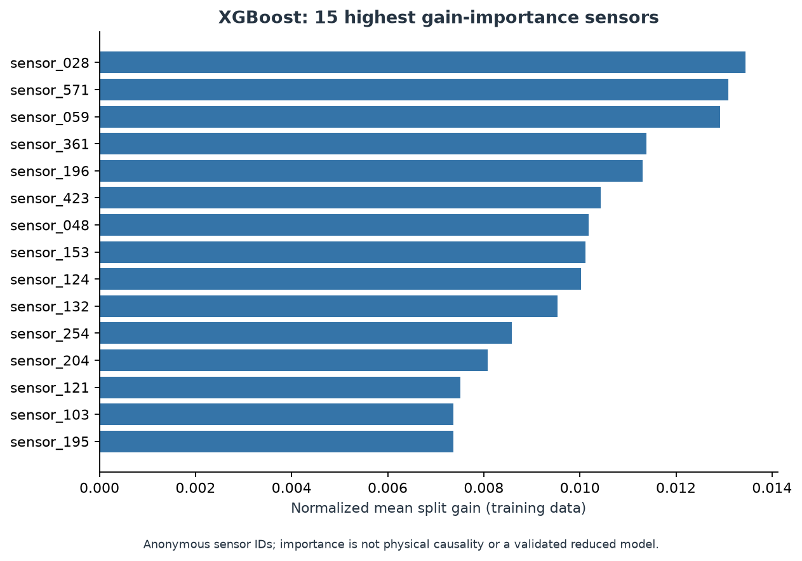

# 09 - Model Interpretation and Engineering Limits

## What I want to learn from importance

After comparing predictions, I inspected which inputs the fitted XGBoost model
uses. The exported gain ranking describes model dependence on the retained
columns. It cannot identify a tool subsystem when sensor meanings are unavailable.

The earlier documentation turned a ranked sensor list into maintenance advice.
That went beyond the evidence. The revised study treats importance as a model
diagnostic and exports exact sensor ranks from the current development-trained XGBoost fit.

## Read the importance definition first

For XGBoost configured with `importance_type="gain"`, importance describes the
average improvement in the training objective for splits using a feature. The
scikit-learn interface normalizes its reported importances. This is distinct
from total gain accumulated across all splits, and from an effect on held-out
performance.

A Random Forest's impurity importance or a logistic regression coefficient has a
different definition. Their numerical values are not interchangeable with gain.
The selected model can also be the dummy or a PCA pipeline, so a table must be
read with its model and representation in mind. PCA coordinates are combinations
of retained sensors; a component's tree importance is not directly an original
sensor's importance. A back-projection through loadings would be an additional
approximation, not a measured sensor effect.

The generated `results/feature_importance.csv` and corresponding figure are
descriptive outputs of XGBoost even when a different candidate is selected. Read
them with that model identity and frozen run context
in [the results index](00_navigation.md#code-and-generated-evidence). The old top
sensor list is not carried forward as a new finding.

## Sources of ambiguity

Correlated sensors can substitute for one another, splitting or concentrating
importance differently across fits. Imputed values also affect which splits are
available. A high-importance column might reflect process conditions, a logging
pattern, or a proxy for another variable. A low-importance column may be redundant
with a stronger correlated column rather than physically irrelevant.

Global gain does not give the direction of an association. It also does not
explain why a particular observation received an alert. Local attribution,
held-out permutation importance, and stability across resamples would answer
additional questions; they are not established merely by exporting a gain table.
Using the holdout to design a smaller feature set would consume it for another
selection decision and require a new evaluation boundary.

## What the completed export establishes

The full-development XGBoost fit ranks `sensor_028`, `sensor_571`, and `sensor_059`
highest by normalized mean split gain. The
[complete table](../results/feature_importance.csv) retains original sensor IDs;
the figure displays its top 15. This is an inspectable description of one fitted
boosting model, even though the original selected pipeline is RF/KNN/SMOTE.

**Takeaway:** the bars quantify how this XGBoost fit uses inputs in its training
splits. They do not show the direction of a sensor effect, explain the selected
Random Forest, or establish a 15-sensor detector's held-out performance. Keeping
the model name and importance definition attached to the figure prevents a
descriptive ranking from becoming an unsupported engineering conclusion.

Sensor meanings, units, acquisition context, and lot/tool identifiers are not
supplied. No physical mapping, intervention, sensor-specific limit, maintenance
outcome, or reduced-feature validation was demonstrated. A high gain value does
not justify replacing or recalibrating a sensor.

## Translate the measured decisions into counts

The selected RF/KNN/SMOTE pipeline supports a different engineering description:
how many labeled failures it flags and how many passing observations it sends
for hypothetical review. On the same **314 holdout rows**, moving from **0.5**
to the development-frozen **0.242222** threshold changes **1 caught failure and
1 review** into **10 caught failures and 52 reviews**. The frozen rule has
**42 false alarms and 11 misses**. That is **9 additional catches for 51
additional reviews**, without changing the model or its **AP 0.2727**.
[Saved operating counts](../results/holdout_metrics.csv).

The supplementary capacity diagnostic makes the constraint explicit: the
selected pipeline catches **15, 20, and 39 of 83 development failures** at
**60, 125, and 250 reviews**, with **45, 105, and 211 passing observations
reviewed**, respectively. These are original OOF scores ranked inside random
validation-fold blocks. This is a measured workload description, not observed
factory inspection throughput or a monetary benefit. The
[diagnostics chapter](13_development_diagnostics.md) defines the budget and tie
rules; the [findings summary](14_findings_and_impact.md) connects the tradeoff to
the completed experiment.

## What remains outside this project

This offline public-data study does not establish real-time availability, stable
future prevalence, calibrated failure probabilities, a validated factory review
capacity, or reduced factory losses. The completed
[capacity analysis](13_development_diagnostics.md) uses hypothetical validation-fold
blocks, not actual inspection batches. The timestamps permit a limited sensitivity
check, but no supplied lot or tool grouping is used to establish independence
between observations. Related rows could appear across a random split.

The engineering value of the completed work is a reproducible way to inspect
ranking, alarm burden, and model dependence on inputs. Claims about physical causes or
yield improvement would require evidence beyond this dataset and experiment.
The [case study](14_findings_and_impact.md) connects these interpretation limits
to measured detection and review outcomes.
