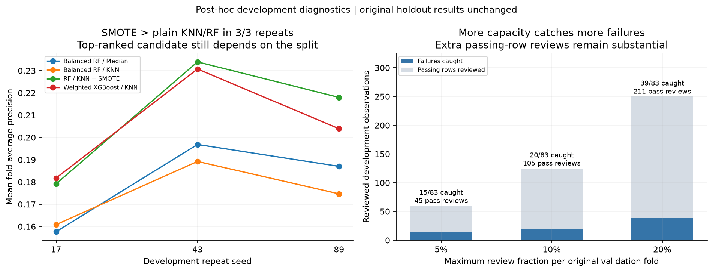

# 13 - Development Stability and Review Capacity

I completed two supplementary checks: how the existing candidates respond to new
development folds and estimator seeds, and how many failures their original OOF
scores recover under a review limit. These are **post-hoc, descriptive analyses
of the original 1,253 development rows and 83 failures**. They reuse development
outcomes; they do not supply an independent performance estimate, replace the
original winner, or retune a threshold on the holdout.



**Takeaway:** in the left panel, XGBoost leads at seed 17 and RF/KNN/SMOTE leads at
43 and 89, among the four checked candidates. SMOTE stays above plain RF/KNN in
all three repeats. In the right panel, increasing the selected pipeline's review
budget catches more failures, but 250 reviews still catch only 39 of 83. The
lines in the left panel connect descriptive measurements, not confidence limits.
The right panel separates caught failures from passing rows reviewed; neither
panel is a forecast of factory performance.

## Repeated comparisons

I kept the original development membership and fixed hyperparameters, ordered
rows by original row ID, and created three shared stratified five-fold partitions.
The splitter seeds are 17, 43, and 89; estimator and SMOTE seeds equal the repeat
seed plus the zero-based fold index. This changes both fold assignment and
estimator randomness, so the result does not isolate either source of variation.
Four existing candidates x three repeats x five folds gives **60 additional CV
fits**, separate from the original seven-candidate, 35-fit comparison.

| Candidate | Seed 17: mean fold AP (rank) | Seed 43: mean fold AP (rank) | Seed 89: mean fold AP (rank) |
| --- | ---: | ---: | ---: |
| Balanced RF / Median | 0.1577 (4) | 0.1968 (3) | 0.1870 (3) |
| Balanced RF / KNN | 0.1608 (3) | 0.1892 (4) | 0.1747 (4) |
| RF / KNN + SMOTE | 0.1792 (2) | 0.2339 (1) | 0.2180 (1) |
| Weighted XGBoost / KNN | 0.1818 (1) | 0.2307 (2) | 0.2039 (2) |

The paired differences **SMOTE minus plain RF/KNN** are **+0.0183, +0.0447, and
+0.0433**, calculated from unrounded values in
[repeat_metrics.csv](../supplementary/development/repeat_metrics.csv).
The positive sign is consistent in these repeats. It supports an observed
advantage for this SMOTE pipeline over this plain RF/KNN pipeline, without
establishing general superiority. KNN also trails Median in two repeats, so the
original KNN-over-Median ordering is not consistent across these checks.

The selected pipeline's development-optimized thresholds range from **0.2375 to
0.2628** across repeats. Those are sensitivity diagnostics, not replacement
thresholds. The original selected model remains `rf_knn_smote`, with threshold
**0.242222** from [protocol.json](../results/protocol.json). Ranks apply only to
these four candidates. The repeated observations and overlapping training sets
make fold SD, AP ranges, and rank counts descriptive; they are not independent
confidence intervals, significance tests, or probabilities of superiority.

## Hypothetical review capacity

I reused the **original** [OOF predictions](../results/oof_predictions.csv), rather
than the repeated scores above. Within each original validation fold, I ranked
scores in descending order and allowed at most `floor(budget * fold_rows)`
reviews. Equal-score groups move together. If the next group exceeds the limit,
it and all lower groups are excluded; capacity may remain unused. A constant
score therefore produces zero reviews at these budgets rather than an arbitrary
selection of tied rows.

| RF / KNN + SMOTE budget per fold | Maximum / actual reviews | Caught / 83 failures | False alarms | Missed failures | Precision | Recall |
| --- | ---: | ---: | ---: | ---: | ---: | ---: |
| 5% | 60 / 60 | 15 / 83 | 45 | 68 | 0.2500 | 0.1807 |
| 10% | 125 / 125 | 20 / 83 | 105 | 63 | 0.1600 | 0.2410 |
| 20% | 250 / 250 | 39 / 83 | 211 | 44 | 0.1560 | 0.4699 |

The maximum counts sum the separately floored fold limits; they are not a single
global top-5%, top-10%, or top-20% selection. I calculate aggregate precision and
recall from summed confusion counts, not averages of fold metrics. The
[per-fold table](../supplementary/development/capacity_by_fold.csv) and
[summary table](../supplementary/development/capacity_summary.csv) expose both the
constraints and outcomes.

At the 10% budget, plain RF/KNN catches **29 failures with 96 false alarms**,
versus SMOTE's **20 with 105**, using the same **125 reviews**. SMOTE's original
mean-fold-AP selection therefore does not imply the best result at this capacity.
This is a retrospective comparison on reused development labels, not a reason to
declare a new selected model. The random validation folds are hypothetical
review blocks, **not actual factory batches**. No measured inspection economics,
prevented losses, or future capacity compliance follow from these counts.

## Evidence and reproduction

```bash
uv run python -m scripts.development_diagnostics --overwrite
```

This uses the existing locked environment and downloads the hash-checked UCI
source if it is not cached. `--overwrite` replaces the supplement in
`supplementary/development/`. The loader validates the full raw files, but all
supplementary fitting and prediction use only the original development rows.
The original holdout is not fitted, rescored, or used to change selection.

| Evidence | What it makes inspectable |
| --- | --- |
| [REPORT.md](../supplementary/development/REPORT.md) | Generated repeat and all-candidate capacity comparisons |
| [repeat_fold_metrics.csv](../supplementary/development/repeat_fold_metrics.csv) | The 60 fold fits and their scores |
| [repeat_assignments.csv](../supplementary/development/repeat_assignments.csv) | Original row IDs and new fold membership |
| [repeat_oof_predictions.csv](../supplementary/development/repeat_oof_predictions.csv) | Scores for reconstructing repeat summaries and thresholds |
| [provenance.json](../supplementary/development/provenance.json) | Original protocol/input hashes, supplementary source hashes, seeds and versions |

The supplementary script sits outside the frozen experiment source-hash set and
records its own provenance. The completed finding is specific: the AP differences
for SMOTE minus RF/KNN are positive in all three repeats, the leading candidate
changes, and a fixed review budget can favor a different ranking. The
[case study](14_findings_and_impact.md) connects those observations to the original
holdout findings and the project's completed outputs.
