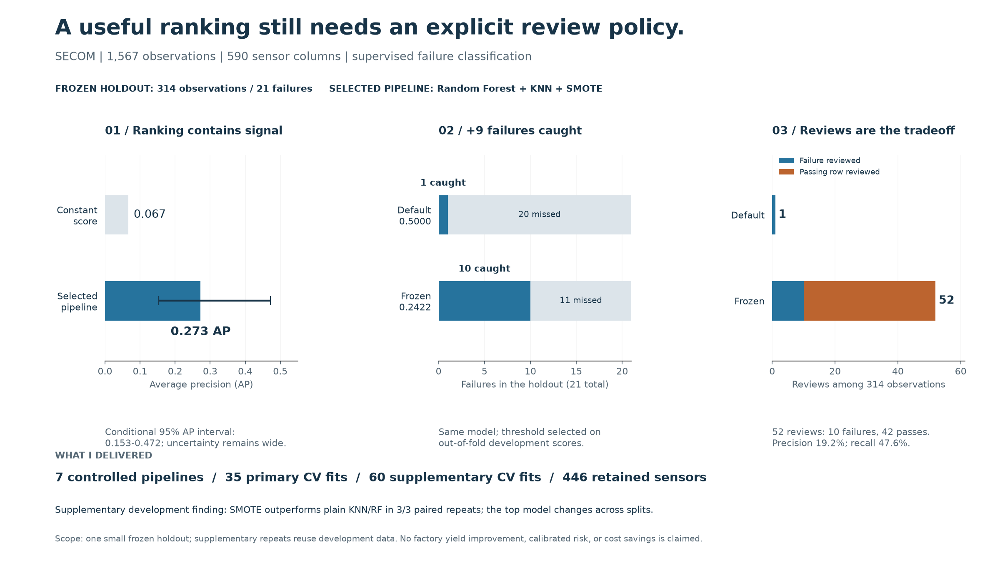
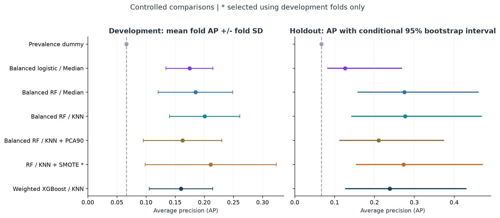
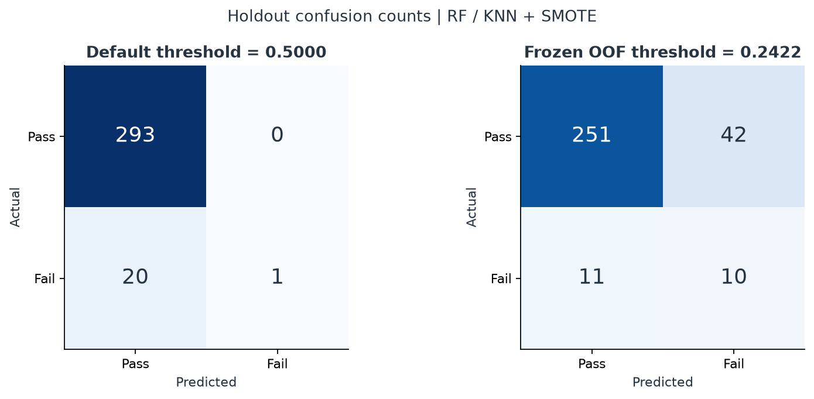
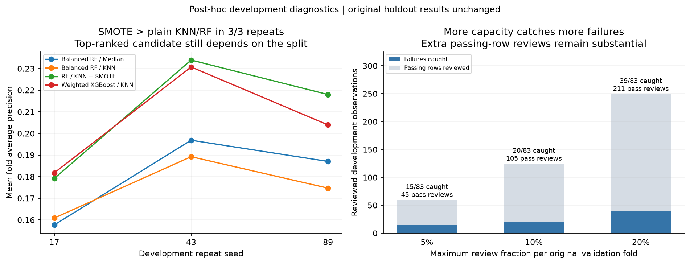

# 14 - Findings and Impact

## The question and the answer

Predicting every SECOM observation as a pass gives about **93.4% accuracy** while
detecting none of the failures. I wanted to know which preprocessing and imbalance
choices improve failure ranking, and what happens when I turn that ranking into
an alert rule. This is supervised classification of supplied labels on a public
dataset; a detected failure means a correctly flagged labeled observation.

The completed comparison selects **Random Forest / KNN + SMOTE** by development
average precision (AP). On **314 holdout observations with 21 failures**, it has
**AP 0.2727**, versus **0.0669** for a constant-score baseline. Its frozen threshold
catches **10 failures in 52 reviews**, with **42 false alarms and 11 misses**.
The result is measurable ranking signal with a substantial review burden.

**Takeaway:** ranking quality, a fixed alert rule, and a capacity limit answer
different questions. The holdout threshold comparison uses one frozen model;
the capacity results use development OOF scores and are labeled separately.
The counts measure detection and workload, without assigning a factory benefit.

## My work

I kept the original investigation's sequence: sensor filtering, Median versus KNN
imputation, PCA, SMOTE, weighted XGBoost, thresholds, and sensor interpretation.
I rebuilt its evaluation so that those attempts could be compared under a stated
rule. I implemented source and schema validation, training-only preprocessing,
shared-fold comparisons, frozen selection, prediction exports, and metric audits.

I also completed development-only repeat and review-capacity diagnostics and
added a saved-pipeline batch interface that exports `row_id`, `score`, `alert`,
and metadata binding the model, input, protocol, and source hashes. The notebook
reconstructs saved metrics from predictions. The
[journal](12_project_journal.md) records the corrections to the original
exploration without inventing a timeline or manufacturing outcomes.

## How I tested the question

1. **Fix the comparison boundary.** Reserve 1,253 development rows and 314 holdout rows with a seeded stratified split. All seven candidates use the same five development folds. Filtering, scaling, imputation, PCA, and SMOTE learn only from each fit's training rows.
2. **Compare specific hypotheses.** Median versus KNN uses the same Random Forest settings; PCA90 and SMOTE are compared with plain RF/KNN. Dummy and logistic models supply simpler references. XGBoost is another fixed candidate. These comparisons test complete pipeline choices, not physical mechanisms.
3. **Separate ranking from decisions.** Mean fold AP selects the candidate. Pooled development out-of-fold (OOF) predictions select each candidate's maximum-F1 threshold. I freeze the selection and thresholds before holdout scoring, then report all candidates without choosing a new winner.
4. **Make the claims reconstructable.** Save row membership, scores, thresholds, confusion counts, versions, and hashes. Report uncertainty, changing repeat ranks, false alarms, and the weak chronological result alongside the stronger results.

The [experiment protocol](11_experiment_protocol.md) defines the exact rules.
AP means scikit-learn `average_precision_score`, not trapezoidal PR area. The
development-optimized OOF F1 is optimistic, and model scores are uncalibrated.

## Quantified outputs

| Completed output | Quantity and evidence |
| --- | --- |
| Validated dataset and split | **1,567 rows, 104 failures, 590 sensors**; **1,253 development / 314 holdout rows**, with **83 / 21 failures**. [Metrics](../results/metrics.json), [row manifest](../results/split_manifest.csv) |
| Learned sensor filter | **590 input sensors -> 446 retained**, removing **144** on full development data; fold masks are learned separately. [Data-quality table](../results/data_quality.csv) |
| Original comparison | **7 pipelines x 5 shared folds = 35 primary CV fits**, excluding full-development refits and the chronological check. [Fold metrics](../results/fold_metrics.csv) |
| Supplementary comparison | **4 candidates x 3 repeats x 5 folds = 60 additional CV fits**. [Repeat fold metrics](../supplementary/development/repeat_fold_metrics.csv) |
| Review-capacity analysis | **7 candidates x 3 budgets = 21 aggregate comparisons**, using original OOF scores. [Capacity summary](../supplementary/development/capacity_summary.csv) |
| Visual evidence | **10 figures: 8 original experiment figures + 1 development diagnostic + 1 findings summary**. The four findings and figure guide below explain their takeaways. |
| Executed metric audit | **16 executed code cells**, with saved tables and figures, reconstruct selection and operating metrics from prediction exports and check source/protocol provenance. [Notebook](../main.ipynb) |
| Reusable inference | A local selected-pipeline bundle and batch CLI with schema checks, frozen-rule alerts, and hash metadata. [Usage](../README.md#use-the-saved-pipeline), [implementation](../scripts/predict.py) |

These are concrete experiment and software outputs. I did not measure engineering
hours saved, monetary return, factory throughput, or manufacturing yield gains.

## Four findings

### 1. There is ranking signal, without a universal winning pipeline

**Takeaway:** RF/KNN/SMOTE leads the original comparison at **0.2110 mean fold AP**,
with **0.1128 fold SD**. Its holdout **AP 0.2727** exceeds the constant-score
**0.0669** reference, but several Random Forest variants have similar holdout AP.
Fold SD describes variation, not a confidence interval. The selected model's
conditional 95% AP interval is **[0.1534, 0.4720]**.

The ablations also qualify my original story. KNN/RF's original mean fold AP is
**0.2007**, versus Median/RF's **0.1848**, but KNN trails Median in two of the three
supplementary repeats. PCA90 lowers the original KNN/RF mean fold AP to **0.1626**;
retaining 90% variance does not guarantee better failure ranking. These are
observed pipeline results, not proof of why an imputer or representation worked.
[Development evidence](../results/development_metrics.csv).

Median/RF has higher frozen holdout F1 (**0.3210**) than the selected pipeline
(**0.2740**). That transparent counterexample does not change the original
development selection. [Full frozen comparison](../results/RESULTS.md).

### 2. The threshold recovers failures by increasing review volume

| Same fitted RF / KNN + SMOTE on 314 holdout rows | Threshold 0.5 | Frozen threshold 0.242222 |
| --- | ---: | ---: |
| Caught failures (TP), out of 21 | 1 | 10 |
| Missed failures (FN) | 20 | 11 |
| Passing observations alerted (FP) | 0 | 42 |
| Passing observations not alerted (TN) | 293 | 251 |
| Total reviews (TP + FP) | 1 | 52 |
| Failure F1 | 0.0909 | 0.2740 |

**Takeaway:** the frozen rule catches **9 additional failures for 51 additional
reviews**. Of the **52 flagged observations, 10 are failures and 42 pass**;
**11 failures remain missed**. Recall is **0.4762**, with Wilson
95% interval **[0.2834, 0.6763]**, and precision is **0.1923**.

This is a same-model, same-score comparison with unchanged AP. The threshold was
selected on development OOF labels, not optimized on holdout labels. It is not a
before/after comparison with the historical test-tuned project, and F1 does not
price the extra reviews. [Operating metrics](../results/holdout_metrics.csv),
[row-level scores](../results/holdout_predictions.csv).

### 3. SMOTE's observed AP advantage repeats, but the leader changes

| Repeat seed | SMOTE minus plain RF/KNN mean fold AP | First among the four checked candidates |
| --- | ---: | --- |
| 17 | +0.0183 | Weighted XGBoost / KNN |
| 43 | +0.0447 | RF / KNN + SMOTE |
| 89 | +0.0433 | RF / KNN + SMOTE |

**Takeaway:** the left panel shows a positive paired AP difference for SMOTE in
all three new repeats, while the leading candidate changes. This supports a
specific observed advantage over plain RF/KNN, not universal superiority.
The same development observations and overlapping training sets are reused;
both fold assignment and estimator randomness change. Ranks and ranges are
descriptive, not independent confidence intervals or significance tests.

The **60 supplementary fits** use fixed existing hyperparameters and only
development rows. They do not replace the original selected model or its
threshold. [Repeat metrics](../supplementary/development/repeat_metrics.csv),
[methods and seed policy](13_development_diagnostics.md).

### 4. Review capacity and forward transfer limit the practical claim

The right panel above uses the **original** development OOF scores, with a
separate review budget inside each of the five original validation folds.

| RF / KNN + SMOTE budget per fold | Actual reviews | Caught / 83 failures | Passing observations reviewed | Missed failures |
| --- | ---: | ---: | ---: | ---: |
| 5% | 60 | 15 / 83 | 45 | 68 |
| 10% | 125 | 20 / 83 | 105 | 63 |
| 20% | 250 | 39 / 83 | 211 | 44 |

**Takeaway:** more reviews catch more failures, but **250 reviews still miss 44
of 83** development failures. At the same **125-review** capacity, plain RF/KNN
catches **29** failures versus SMOTE's **20**. The AP-selected model does not
automatically maximize detection at a specific capacity.

Each block allows at most `floor(budget * block_rows)` reviews; whole score ties
are preserved, so capacity can remain unused. Counts sum across blocks, rather
than selecting one global top fraction. These are hypothetical random-fold
blocks, not factory batches, and retrospective policy comparisons on reused
development labels are optimistic. [Capacity evidence](../supplementary/development/capacity_summary.csv).

The separate **fixed-XGBoost** chronological check is a second practical limit:
on 251 later-development rows with 14 failures, **AP is 0.0967** against prevalence
**0.0558**, with **zero recall** at its earlier-selected threshold **0.267113**.
I retain this weak result. It is a check of that candidate and threshold, not an
assessment of every model or of the selected RF/KNN/SMOTE pipeline's temporal
performance. [Chronological evidence](../results/RESULTS.md#chronological-sensitivity).

## Read the other diagnostic figures

The AP comparison and confusion matrix above are two of the eight original
figures. The other six retain the original investigation's diagnostic arc:

| Figure | Takeaway and evidence boundary |
| --- | --- |
| [Missingness](../images/missingness.png) | The training rules retain **446 of 590** full-development sensors. Fold masks are learned separately; incomplete measurements do not diagnose broken equipment. [Sensor table](../results/data_quality.csv) |
| [PCA variance](../images/pca_variance_comparison.png) | Median and KNN reach 90% full-development variance at **128 and 127 components**. Similar variance curves do not demonstrate equivalent failure information or imputation accuracy. [Fold-specific dimensions](../results/fold_metrics.csv) |
| [Precision-recall curves](../images/pr_curve.png) | The selected model's frozen dot has **0.4762 recall / 0.1923 precision**. Ranking above prevalence can coexist with mostly false alerts; a holdout curve is not a threshold-selection tool. |
| [Threshold sensitivity](../images/threshold_sensitivity.png) | This is **XGBoost's development OOF** curve: selected threshold **0.136989**, optimized F1 **0.2332**. It is not the selected RF pipeline's threshold or an independent performance estimate. |
| [Score distributions](../images/score_distribution.png) | **XGBoost** development-fold and full-refit holdout models are different fitted objects. The frozen rule yields **9 catches / 52 false alarms / 61 reviews** on holdout; the panels do not isolate the cause of transfer differences or establish calibration. |
| [Feature importance](../images/feature_importance.png) | `sensor_028`, `sensor_571`, and `sensor_059` lead **XGBoost's normalized mean split gain** ranking. It describes that fitted model, not a causal fault or a validated reduced-sensor detector. [Full ranking](../results/feature_importance.csv), [interpretation](09_model_interpretability_and_engineering_translation.md) |

## Limits of the completed evidence

- **Prior exploration and small support:** SECOM was already explored. The revised holdout is excluded from within-run fitting and selection, not historically unseen. It contains only **21 failures**; one additional catch changes recall by **0.0476**. The reported intervals are conditional on this sample and fitted scores, not all training or selection uncertainty.
- **Dependence and transfer:** random splits do not establish independence across lots, tools, or time. Repeated development checks reuse observations; the narrow XGBoost temporal check does not validate every candidate's transfer.
- **Interpretation:** anonymous sensor IDs, unknown missingness mechanisms, and uncalibrated scores limit physical interpretation. Gain ranks do not establish failure causes or maintenance actions.
- **Operational impact:** hypothetical review blocks and unknown inspection costs do not measure prevented losses, production reliability, factory throughput, or yield improvement.

## Conclusion

I turned an accuracy puzzle into a reproducible comparison that distinguishes
ranking, threshold choice, and review capacity. The frozen selected pipeline
shows ranking signal and catches **10 of 21 failures with 42 false alarms**;
the threshold comparison quantifies **9 additional catches for 51 additional
reviews**. My completed contribution is the controlled comparison, reconstructable
evidence, explained visualizations, development diagnostics, and reusable batch
scoring. Those outputs establish what this offline study found and what it
measured, with factory outcomes outside its scope.
