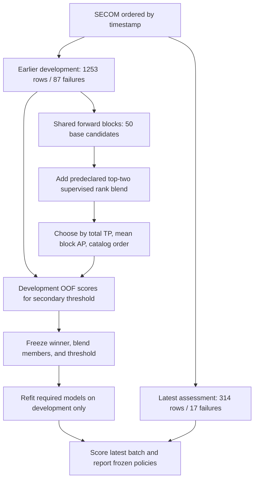

# SECOM Smart Manufacturing Protocol

This study turns SECOM failure detection into a practical review-allocation problem: **which items should receive limited additional quality review in a completed batch?** It searches a broad, fixed catalog and selects the ranking that flags the most recorded failures at a 20% review budget on chronological development data. Here, a failure is "caught" when a recorded failing item is flagged for review; catching it does not establish that an intervention prevents the failure.

The [generated results report](../manufacturing_results/RESULTS.md) contains the selected recipe, measured detection counts, reference comparisons, and six figures derived from the run's stored outputs. This document defines the procedure and how to interpret that evidence. The [frozen protocol and full candidate catalog](../manufacturing_results/protocol.json) are the machine-readable specification.

## Protocol Summary

| Decision | Frozen rule |
|---|---|
| Data | UCI SECOM: 1,567 observations, 590 sensor columns, 104 failures and 1,463 passes; checksum-verified source files |
| Labels | Pass = 0; failure = 1; higher scores always indicate greater failure risk |
| Chronology | Earlier 1,253 observations, including 87 failures, for development; latest 314 observations, including 17 failures, for assessment |
| Search | 50 catalog base candidates plus one predeclared top-two supervised rank blend: 51 search entries |
| Primary objective | Maximize the sum of true positives across three forward development blocks, with exactly `floor(0.20 * block_size)` reviews in each block |
| Candidate ties | Higher unweighted mean block average precision (AP), then fixed catalog order; the blend is last on an exact tie |
| Score ties | Ascending SHA-256 of `seed:original_row_id`, then row ID if hashes collide; labels never resolve a tie |
| Preprocessing | Fit every learned transformation on the corresponding training partition; fit novelty pipelines on passing training rows only |
| Secondary policy | Five-fold stratified development out-of-fold (OOF) maximum-F2 threshold, subject to at most 20% OOF alerts |
| Assessment | Freeze the winner, blend members, and secondary threshold before scoring the latest block; refit required models on development only |
| Comparators | Refit `v2_rf_knn_smote` and `dummy_prior` using the same chronology, assessment batch, and primary review budget |
| Budget sensitivity | Describe 5%, 10%, 20%, 30%, and 50% assessment review budgets for the frozen selected ranking and both references |
| Defaults | Seed 2026; two jobs; 2,000 AP bootstrap replicates; output directory `manufacturing_results` |

"Best" means the highest-ranked completed entry under these declared development rules. It does not establish the globally best SECOM detector or state-of-the-art performance.

## Chronological Development And Assessment

Rows are stably ordered by recorded timestamp. Split boundaries use the nearest allowable boundary between timestamp groups, preferring the earlier boundary on equal distances. Equal timestamps stay together, and each training window strictly precedes its validation window. Every candidate uses the same three expanding development splits.

| Forward block | Training rows | Training failures | Validation rows | Validation failures | Exact review slots |
|---|---:|---:|---:|---:|---:|
| 1 | 501 | 59 | 250 | 8 | 50 |
| 2 | 751 | 67 | 251 | 9 | 50 |
| 3 | 1,002 | 76 | 251 | 11 | 50 |
| Combined validation | Expanding windows | Overlapping training sets | 752 | 28 | 150 |

The earliest 501 development rows supply the initial training window. Validation covers the remaining 752 development rows once each; earlier validation observations enter later training windows. The 314-row assessment block is outside all development splits. Its primary allocation is exactly `floor(0.20 * 314) = 62` reviews, or about 19.7% of the batch after rounding down.



The latest block is protected from fitting, model selection, blend-member selection, and threshold selection **within this run**. SECOM and its labels were already explored in the earlier v2 study. This temporal boundary therefore supplies a within-run assessment on a previously explored public dataset, rather than historically unseen or external validation.

## Search Space

The counts below come from the 50 entries in `protocol.json.catalog`. They comprise **47 supervised recipes, two pass-only novelty recipes, and one prior dummy**. The additional rank blend is defined by the protocol and brings the declared search to 51 entries; completed-entry counts and fit warnings are recorded separately.

| Model group | Base count | Declared variations |
|---|---:|---|
| v2 random forest reference | 1 | Original KNN-imputation and SMOTE recipe, 300 trees |
| Random forest | 4 | Minimum leaf size 2 or 8; no class weight or balanced weight |
| Extra Trees | 6 | Minimum leaf size 1, 4, or 12; no class weight or balanced weight |
| Balanced random forest | 2 | Minimum leaf size 2 or 8; balanced internal sampling |
| XGBoost | 8 | All retained sensors or ANOVA top 100; depth 2 or 3; positive weight 1 or training pass/failure ratio |
| Histogram gradient boosting | 4 | All retained sensors or ANOVA top 100; 7 or 15 leaves; balanced class weight |
| RBF support vector classifier | 6 | ANOVA top 100; `C` = 0.1, 1, or 10; gamma `scale` or `auto`; balanced class weight |
| Linear support vector classifier | 3 | ANOVA top 100; `C` = 0.01, 0.1, or 1; balanced class weight |
| Logistic regression | 6 | ANOVA top 100; `C` = 0.01, 0.1, or 1; no class weight or balanced weight |
| K-nearest neighbors | 4 | ANOVA top 30 or 100; 5 or 21 neighbors; distance weighting |
| Shrinkage linear discriminant analysis | 1 | ANOVA top 100; automatic shrinkage |
| Gaussian naive Bayes | 2 | ANOVA top 100; variance smoothing `1e-9` or `1e-7` |
| Isolation Forest | 1 | Passing training rows only; 300 trees; automatic contamination |
| One-Class SVM | 1 | Passing training rows only; RBF kernel; `nu=0.05`; PCA retaining 90% training variance |
| Prior dummy | 1 | Constant training-prior score |
| **Base catalog total** | **50** | **47 supervised + 2 novelty + 1 dummy** |
| Predeclared rank blend | +1 | Equal mean of within-batch percentile ranks from the two highest-ranked supervised base candidates |
| **Declared search total** | **51** | **50 base recipes + 1 blend** |

This space covers nonlinear tree ensembles, linear and kernel classifiers, distance-based learning, distributional baselines, imbalance handling, and pass-only novelty scoring. Parameters are fixed in advance; for example, the boosted models use 300 boosting iterations, learning rate 0.05, and explicit regularization. The JSON catalog supplies the complete settings.

Supervised failure detection is the main task because labeled passes and failures are available. Novelty pipelines use those labels to identify passing training rows, and their validation scores are evaluated against known failure labels. They are useful pass-only comparators, but this study does not test discovery of novel, previously unseen failure modes. All completed base entries and the blend compete under the same primary objective.

### Training-Only Feature Preparation

The new pipelines retain sensors with at most 95% training missingness and either observed value variation or varying missingness. Thus a sensor with a constant observed value can remain informative through its missingness pattern. Training masks, imputation values, scaling, feature selection, PCA, class ratios, and any resampling are learned separately for each fit. Assessment values and labels do not determine these transformations.

| Pipeline group | Feature preparation |
|---|---|
| New random forests, Extra Trees, balanced random forests, dummy | Training sensor pruning, median imputation, and training-observed missingness indicators |
| Linear, kernel, neighbor, discriminant, and naive Bayes classifiers | Same pruning and imputation; robust scaling; training-label ANOVA feature selection as specified in the catalog |
| XGBoost and histogram gradient boosting | Retain native NaNs in selected sensor values and append training-observed missingness indicators; ANOVA variants use training medians only to compute selection scores |
| Pass-only novelty models | Fit the entire preprocessing pipeline and estimator on passing training rows; robust scaling; One-Class SVM additionally uses training-only PCA90 |
| v2 reference | Original nonconstant-sensor filter with at most 50% missingness, standard scaling, five-neighbor KNN imputation, training-only SMOTE, and balanced random forest |

For native-NaN boosting, `k=100` selects up to 100 sensor values and then appends the missingness indicators; it is not a limit of 100 total output columns. For median-imputed classifiers, ANOVA operates on the transformed features, which include missingness indicators. ANOVA keeps only varying features with defined scores, clamps the requested count to those available, and resolves equal scores in original feature order.

The v2 reference delegates to its original recipe builder in [secom/modeling.py](../secom/modeling.py). It is refitted on the current chronological training partitions. Comparisons use its current assessment predictions; old v2 random-split scores do not form a like-for-like baseline for this study.

## Primary Model And Review Selection

For each completed base candidate, the procedure fits a fresh pipeline on each forward training window, scores its next validation window, and assigns exactly 50 review slots in that window. The first selection statistic is the **sum of true positives across the three blocks**, out of 28 validation failures. Since all candidates face the same failure support and review slots, this directly compares failure capture at equal review workload.

Candidate ordering uses descending total true positives, then descending unweighted mean of the three block AP values, then fixed catalog order. Runtime is recorded but does not break ties. Failed entries are unavailable for selection; warnings and failures appear in `fit_notes.json`.

The two highest-ranked supervised base candidates supply the predeclared blend. For each validation batch, each member's scores become average ranks divided by batch size; the blend is their equal mean. There is no weight tuning. This single blend is evaluated under the same capacity rule and enters the overall ordering after the base catalog, so it loses an exact metric tie to a base entry.

Blend membership is selected using the same development labels used to evaluate the blend. Its development performance therefore reuses an optimistic selection process. More generally, the shared inner development blocks support model choice, and their leaderboard statistics are not independent performance estimates. The outer latest block supplies the protected assessment for the frozen choice within this run.

For every batch allocation, descending score is followed by ascending SHA-256 of the ASCII string `2026:row_id`, then row ID if hashes collide. This makes constant-score and boundary ties deterministic without consulting labels. The prior dummy consequently gives one reproducible allocation, distinct from the theoretical expectation over random allocations.

## Secondary OOF Threshold

The top three supervised base candidates receive five-fold stratified, shuffled development OOF scoring with seed 2026 and shared folds. Each OOF score comes from a model that excludes that observation from fitting. These folds mix development times, so they serve the secondary threshold procedure rather than the primary forward-time comparison. If a selected base winner is outside those three, its own OOF scoring is also produced. A selected blend combines its two members' ranks within each OOF validation fold.

For the already selected winner, threshold selection maximizes

```text
F2 = 5 * TP / (4 * failures + alerts)
```

subject to at most `floor(0.20 * 1253) = 250` pooled development OOF alerts. Thresholds include whole observed score groups and use `score >= threshold`; exact F2 ties retain the higher threshold. If no legal threshold catches a failure, the stored threshold is `None`, meaning zero threshold alerts.

This threshold never overrides the primary temporal model choice or the exact batch-capacity policy. The OOF cap is a constraint on those development scores only. **It gives no 20% alert-cap guarantee after refitting, on assessment, or on another batch.** Its OOF F2 is measured on the labels used to choose the threshold and is not an independent estimate. Model scores and blend ranks are uncalibrated, so a score is not a defect probability.

## Assessment And Visual Evidence

After `selection.json` freezes the winner, member recipes, and secondary threshold, required models are fitted on all 1,253 development rows. The selected ranking, refitted v2 reference, and dummy reference score the same latest 314 rows. The primary comparison records TP, FN, FP, TN, recall, precision, F scores, review counts, and reviews per flagged failure at 62 reviews per strategy. AP and ROC AUC describe the score rankings.

The five assessment budgets are descriptive views of those frozen rankings. They do not select another model, blend, threshold, or preferred operating budget.

| Assessment budget | 5% | 10% | 20% primary | 30% | 50% |
|---|---:|---:|---:|---:|---:|
| Exact reviews out of 314 | 15 | 31 | 62 | 94 | 157 |

At primary capacity, theoretical random review flags `62 * 17 / 314`, approximately 3.36 failures in expectation. Its stored 95% hypergeometric catch range describes random allocation without replacement, not uncertainty in a model improvement. Recall uses a Wilson interval; with only 17 assessment failures, one extra flagged failure changes recall by about 5.9 percentage points. The selected AP interval uses 2,000 class-stratified, fixed-score bootstrap replicates, conditional on the fitted model and observed assessment prevalence. It does not incorporate search uncertainty, refitting variation, temporal dependence, or changes in production conditions.

The [results report](../manufacturing_results/RESULTS.md) places the following figures alongside their numerical tables and interpretation limits. Figure generation reads stored outputs and performs no model fitting or selection.

| Figure | Practical reading |
|---|---|
| [Outcome summary](../manufacturing_results/figures/outcome_summary.png) | Compare flagged failures, passing-item alerts, and review precision at equal capacity; random review is an expectation |
| [Detection versus capacity](../manufacturing_results/figures/detection_vs_capacity.png) | Read failures flagged at the five declared review budgets for the selected model and references |
| [Development search](../manufacturing_results/figures/model_search.png) | Inspect the top development entries in frozen selection order; these are reused selection statistics |
| [Temporal composition](../manufacturing_results/figures/temporal_evaluation.png) | Read weekly observation counts and recorded failure fractions across the partition boundary |
| [Precision-recall comparison](../manufacturing_results/figures/pr_curve.png) | Compare ranking AP and primary capacity points; AP is average precision, not trapezoidal PR area |
| [Cost sensitivity](../manufacturing_results/figures/cost_sensitivity.png) | Read selected-minus-expected-random simulated cost under explicit effectiveness and escape-cost assumptions |

A capacity point that splits tied scores need not lie on a score-threshold precision-recall curve. Weekly composition uses timestamps and labels and does not establish sensor drift, missingness changes, or causal process changes. Observed ties or losses against a reference retain their direction in the report.

## Cost Interpretation

Cost scenarios normalize one additional review to one unit and calculate

```text
simulated_cost = reviews + (failures - effectiveness * TP) * escape_cost
                 + FP * passing_hold_cost
```

| Assumption | Declared values |
|---|---|
| Review cost | 1 normalized unit per reviewed item |
| Escaped-failure cost | 1, 2, 5, 10, 20, 50, or 100 review-cost units |
| Intervention effectiveness | 0.25, 0.50, 0.75, or 1.00 of flagged failures averted |
| Additional passing-item hold cost | 0 or 2 review-cost units per false alert |
| Strategies | No additional review, review everything, expected random review at primary capacity, selected model, v2 reference, and dummy |

All 56 assumption combinations are reported per strategy. `difference_vs_random` is strategy cost minus expected random-review cost; a negative value is a simulated benefit under that combination. The heatmap shows the 28 combinations with passing-item hold cost fixed at zero, while `cost_scenarios.csv` contains both hold-cost settings.

These are scenario assumptions, not fitted intervention effects or observed factory costs. Actual yield improvement, throughput gains, and financial savings are not measured. Batch size and review allocation describe an analytical workload; they do not measure production capacity. Sensor and label availability at a real production decision time is unverified, which limits claims about early warning and operational use.

## Reproduction And Batch Recipe

From the repository root, reproduce the frozen procedure with

```bash
uv run python -m smartfab.study --overwrite
```

The default command verifies or downloads the raw UCI files under `data/raw` and writes to `manufacturing_results`. `--overwrite` explicitly permits replacing existing run outputs. The protocol records raw-data checksums, the split-manifest hash, the candidate catalog, configuration, and SHA-256 hashes of the study sources, `pyproject.toml`, and `uv.lock`. The selection records the protocol hash; assessment checks that both frozen JSON files retain their hashes. Metrics record the environment versions used for the run.

| Evidence | Role |
|---|---|
| [protocol.json](../manufacturing_results/protocol.json) | Pre-search specification, complete catalog, data identity, and source hashes |
| [split_manifest.csv](../manufacturing_results/split_manifest.csv), [forward_membership.csv](../manufacturing_results/forward_membership.csv) | Original row IDs, chronological partition, labels, and per-block training/validation assignments |
| [search_summary.csv](../manufacturing_results/search_summary.csv), [search_blocks.csv](../manufacturing_results/search_blocks.csv), [forward_predictions.csv](../manufacturing_results/forward_predictions.csv) | Development ordering, block statistics, and scores |
| [fit_notes.json](../manufacturing_results/fit_notes.json), [finalist_oof.csv](../manufacturing_results/finalist_oof.csv) | Fit warnings/failures and supervised-finalist OOF scores; `winner_oof.csv` records additional winner scoring when applicable |
| [selection.json](../manufacturing_results/selection.json) | Choice and secondary threshold frozen before assessment |
| [metrics.json](../manufacturing_results/metrics.json), [assessment_predictions.csv](../manufacturing_results/assessment_predictions.csv) | Measured assessment outcomes, intervals, environment, scores, and primary decisions |
| [assessment_budgets.csv](../manufacturing_results/assessment_budgets.csv), [cost_scenarios.csv](../manufacturing_results/cost_scenarios.csv) | Descriptive budget sweep and explicit cost scenarios |
| [RESULTS.md](../manufacturing_results/RESULTS.md) | Generated numerical report and figures |
| `manufacturing_results/artifacts/selected_model.joblib` | Fitted prediction bundle, including sensor schema, member pipelines, policies, and recipe hashes; ignored by Git |

For a completed unlabeled batch, the prediction recipe is:

1. Supply a nonempty CSV containing the exact 590 training sensor headers, `sensor_000` through `sensor_589`. Column order is restored from the bundle. Sensor values must be finite real numbers or blanks for missing values; label columns and extra sensor columns are rejected. Each row must contain an observed sensor retained by every selected member.
2. Include an optional unique integer `unit_id` for each item. Stable IDs preserve tied-score allocations when input order changes. Without IDs, the CLI uses zero-based batch positions, so tied allocations can change after reordering.
3. Use the matching model bundle, `protocol.json`, `selection.json`, and frozen source files. The CLI checks their hashes and recipe consistency. Load only a trusted joblib bundle because model deserialization executes Python code.
4. Score the complete batch using the fitted transformations. Read `review` as the primary queue, containing exactly `floor(0.20 * batch_size)` items. Read `threshold_alert` as the separate frozen secondary policy, with no capacity guarantee.
5. Retain the output CSV and accompanying `.metadata.json` file, which records input and recipe hashes, source hashes, policy settings, row count, and ID handling.

```bash
uv run python -m smartfab.predict \
  --model manufacturing_results/artifacts/selected_model.joblib \
  --protocol manufacturing_results/protocol.json \
  --selection manufacturing_results/selection.json \
  --input batch.csv \
  --output batch_predictions.csv
```

The CSV output contains `unit_id`, `score`, `review`, and `threshold_alert`. The primary queue requires the complete batch; blend scores also depend on within-batch ranks. This is a reproducible review-prioritization recipe with retrospective quality-detection evidence, bounded by the dataset history, small failure support, unverified feature timing, and explicitly assumed intervention economics.

## Implementation Sources

- [smartfab/study.py](../smartfab/study.py): frozen protocol, development search, secondary OOF scoring, assessment, cost scenarios, and artifact creation.
- [smartfab/models.py](../smartfab/models.py): base catalog, training-local transformations, pass-only fitting, and score direction.
- [smartfab/policies.py](../smartfab/policies.py): chronological splits, deterministic capacity allocation, rank blending, and F2 threshold selection.
- [smartfab/predict.py](../smartfab/predict.py): unlabeled batch schema, recipe verification, prediction outputs, and metadata.
- [smartfab/reporting.py](../smartfab/reporting.py): stored-result tables, narrative, and six figures without refitting or reselection.
- [UCI SECOM dataset](https://doi.org/10.24432/C54305): published data source, licensed CC BY 4.0.
