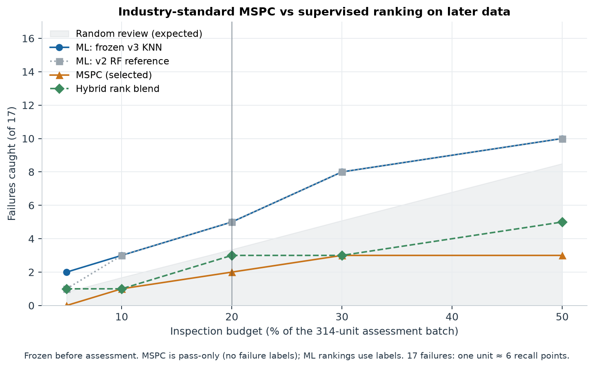
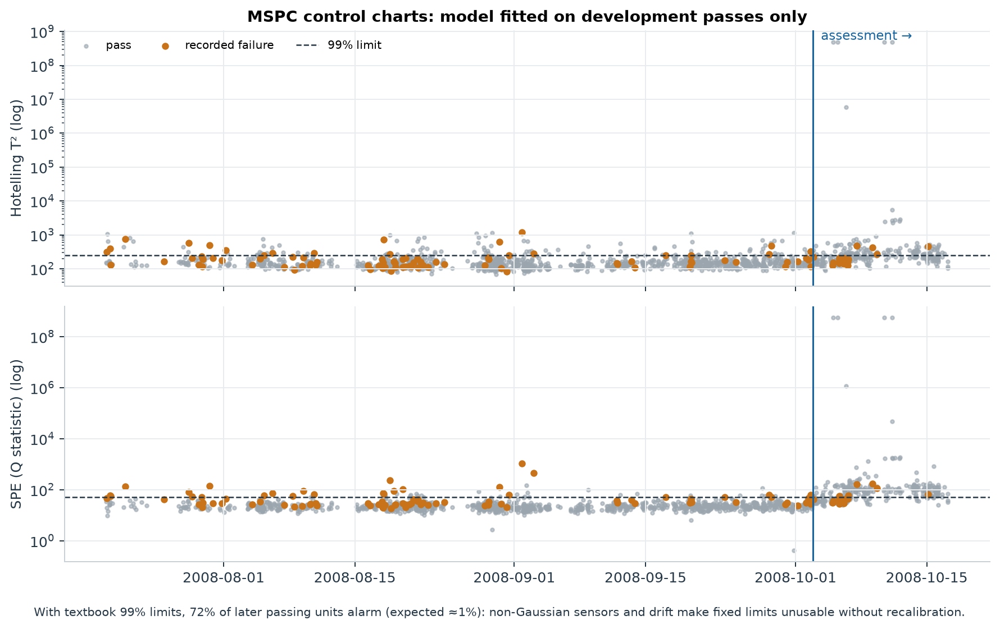
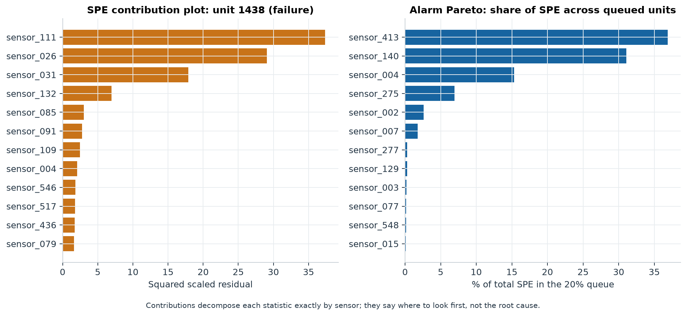
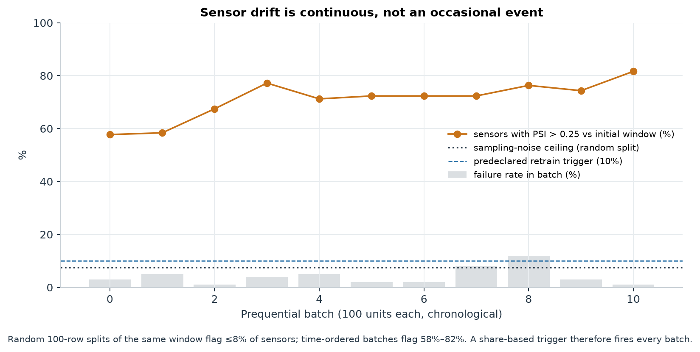
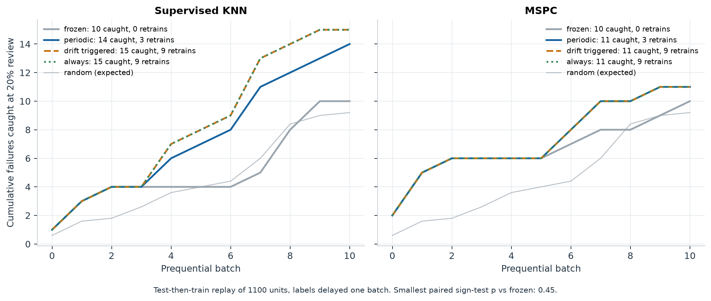
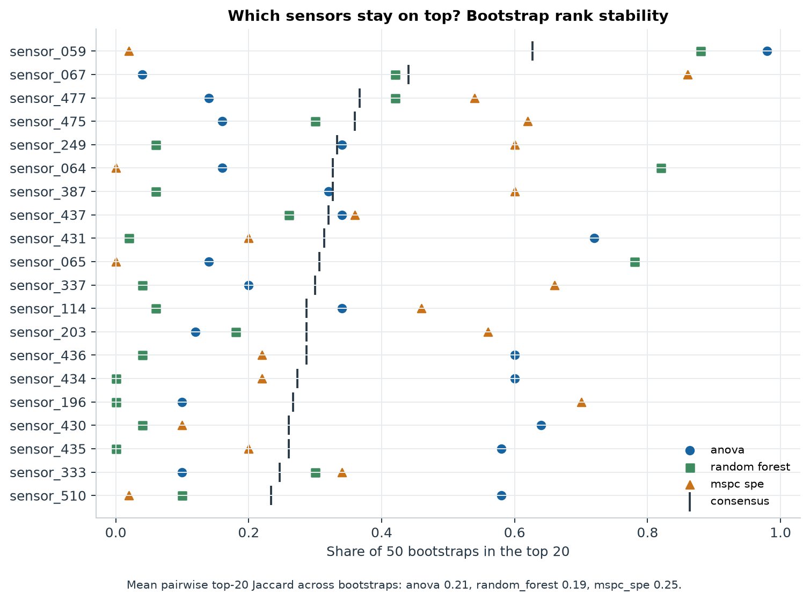

# Fab-monitoring results

Generated by `python -m fabops.study`. Every number below comes from the CSV/JSON files in this folder.

## 1. MSPC baseline vs supervised ranking (same frozen split, same 20% budget)

Selected MSPC on development forward blocks: **`mspc_var95_spe`** (167 components, 95% variance, 586 sensors, fitted on 1166 development passes).

| Strategy (assessment, 62 reviews) | Failures caught | Passing units flagged | Review precision | AP |
|---|---:|---:|---:|---:|
| ML: frozen v3 KNN | 5 / 17 | 57 | 8.1% | 0.068 |
| ML: v2 RF reference | 5 / 17 | 57 | 8.1% | 0.077 |
| MSPC (selected) | 2 / 17 | 60 | 3.2% | 0.041 |
| Hybrid rank blend | 3 / 17 | 59 | 4.8% | 0.053 |
| Random review (expected) | 3.36 / 17 | – | 5.4% | – |

Catch overlap at 20%: KNN only 4, MSPC only 1, both 1, neither 11.

Classic control-chart decision (alarm when T² or SPE exceeds its 99% limit):

| Limits | Development pass alarm rate (in-sample) | Assessment pass alarm rate | Alarms | Failures caught |
|---|---:|---:|---:|---:|
| theoretical limits | 9.2% | 72.1% | 220 | 6 / 17 |
| empirical limits | 2.0% | 64.3% | 196 | 5 / 17 |

Top alarm-Pareto sensors (share of SPE in the 20% MSPC queue): `sensor_413` 36.9%, `sensor_140` 31.1%, `sensor_004` 15.3%, `sensor_275` 6.9%, `sensor_002` 2.6%.

## 2. Drift monitoring

- Assessment block vs development: **59%** of 468 informative sensors have PSI > 0.25; 71% fail KS at BH q < 0.01.
- Noise floor: random 100-row splits of one window flag 4.7% on average (max 7.5%); the last 100 rows *in time* of the same window flag 51%.
- Per prequential batch vs the initial window: 58%, 58%, 67%, 77%, 71%, 72%, 72%, 72%, 76%, 74%, 82%.

## 3. Retraining policies (prequential, labels delayed one batch)

| Model | Policy | Caught / failures | Retrains | vs frozen | Batches better / worse | Sign-test p |
|---|---|---:|---:|---:|---:|---:|
| v3_selected_knn | frozen | 10 / 46 | 0 | +0 | 0 / 0 | 1.00 |
| v3_selected_knn | periodic | 14 / 46 | 3 | +4 | 5 / 2 | 0.45 |
| v3_selected_knn | drift_triggered | 15 / 46 | 9 | +5 | 4 / 2 | 0.69 |
| v3_selected_knn | always | 15 / 46 | 9 | +5 | 4 / 2 | 0.69 |
| mspc | frozen | 10 / 46 | 0 | +0 | 0 / 0 | 1.00 |
| mspc | periodic | 11 / 46 | 3 | +1 | 2 / 1 | 1.00 |
| mspc | drift_triggered | 11 / 46 | 9 | +1 | 2 / 1 | 1.00 |
| mspc | always | 11 / 46 | 9 | +1 | 2 / 1 | 1.00 |

## 4. Sensor ranking stability

Top-20 Jaccard, mean over bootstrap pairs: anova 0.21, random_forest 0.19, mspc_spe 0.25; across time slices: anova 0.01, random_forest 0.04, mspc_spe 0.01; between methods (full development data): anova vs random_forest 0.05, anova vs mspc_spe 0.00, random_forest vs mspc_spe 0.05.

Watchlist tiers: {'exploratory': 572, 'moderate': 17, 'stable': 1}.

| Sensor | Tier | Consensus bootstrap freq | ANOVA | RF | MSPC-SPE | Time-slice freq | Later std. mean diff | Later PSI |
|---|---|---:|---:|---:|---:|---:|---:|---:|
| `sensor_059` | stable | 0.63 | 0.98 | 0.88 | 0.02 | 0.25 | -0.02 | 0.74 |
| `sensor_067` | moderate | 0.44 | 0.04 | 0.42 | 0.86 | 0.25 | -0.06 | 0.79 |
| `sensor_477` | moderate | 0.37 | 0.14 | 0.42 | 0.54 | 0.17 | +0.01 | 0.10 |
| `sensor_475` | moderate | 0.36 | 0.16 | 0.30 | 0.62 | 0.25 | +0.06 | 0.46 |
| `sensor_249` | moderate | 0.33 | 0.34 | 0.06 | 0.60 | 0.17 | -0.09 | 0.00 |
| `sensor_064` | moderate | 0.33 | 0.16 | 0.82 | 0.00 | 0.17 | -0.03 | 0.33 |
| `sensor_387` | moderate | 0.33 | 0.32 | 0.06 | 0.60 | 0.17 | -0.09 | 0.00 |
| `sensor_437` | moderate | 0.32 | 0.34 | 0.26 | 0.36 | 0.25 | -0.13 | 0.10 |
| `sensor_431` | moderate | 0.31 | 0.72 | 0.02 | 0.20 | 0.00 | +0.18 | 0.20 |
| `sensor_065` | moderate | 0.31 | 0.14 | 0.78 | 0.00 | 0.08 | -0.11 | 0.20 |
| `sensor_337` | moderate | 0.30 | 0.20 | 0.04 | 0.66 | 0.00 | +0.06 | 0.52 |
| `sensor_114` | moderate | 0.29 | 0.34 | 0.06 | 0.46 | 0.17 | -0.09 | 0.00 |
| `sensor_203` | moderate | 0.29 | 0.12 | 0.18 | 0.56 | 0.17 | +0.06 | 0.40 |
| `sensor_436` | moderate | 0.29 | 0.60 | 0.04 | 0.22 | 0.00 | -0.40 | 0.28 |
| `sensor_434` | moderate | 0.27 | 0.60 | 0.00 | 0.22 | 0.00 | +0.40 | 0.06 |

## Limits

- 17 assessment failures and 46 replay failures: differences of a few units are within noise.
- SECOM sensors are anonymised; contributions and rankings are inspection priorities, not root causes.
- Replay retraining uses the full timeline, including the v3 assessment block, as a separate operational simulation; it never feeds back into model selection.
