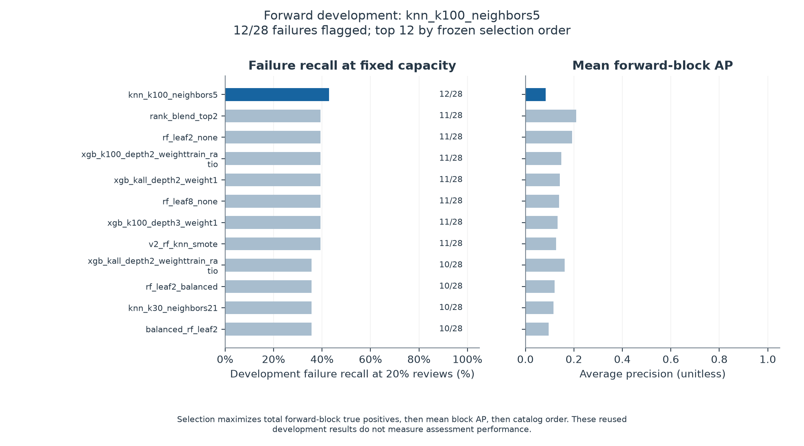
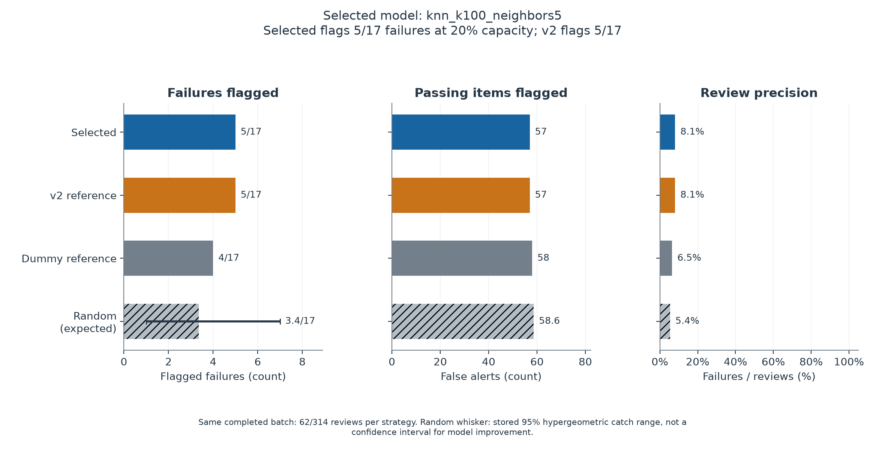
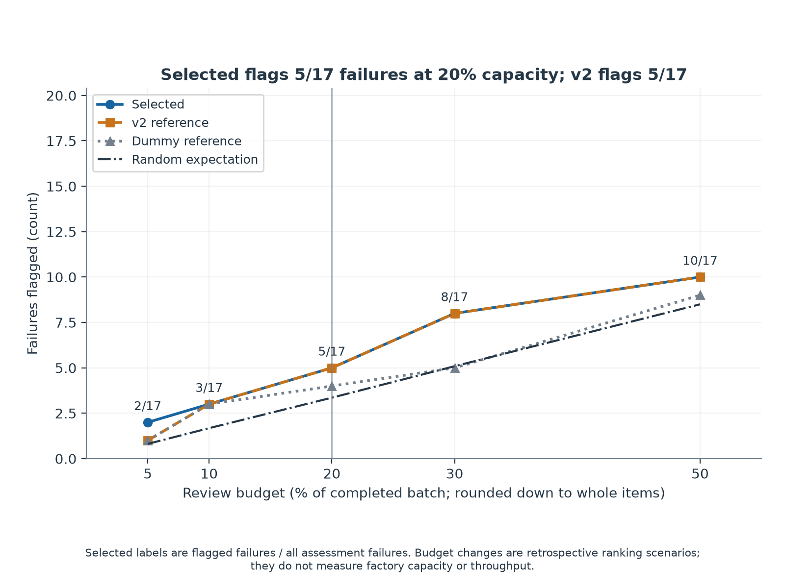
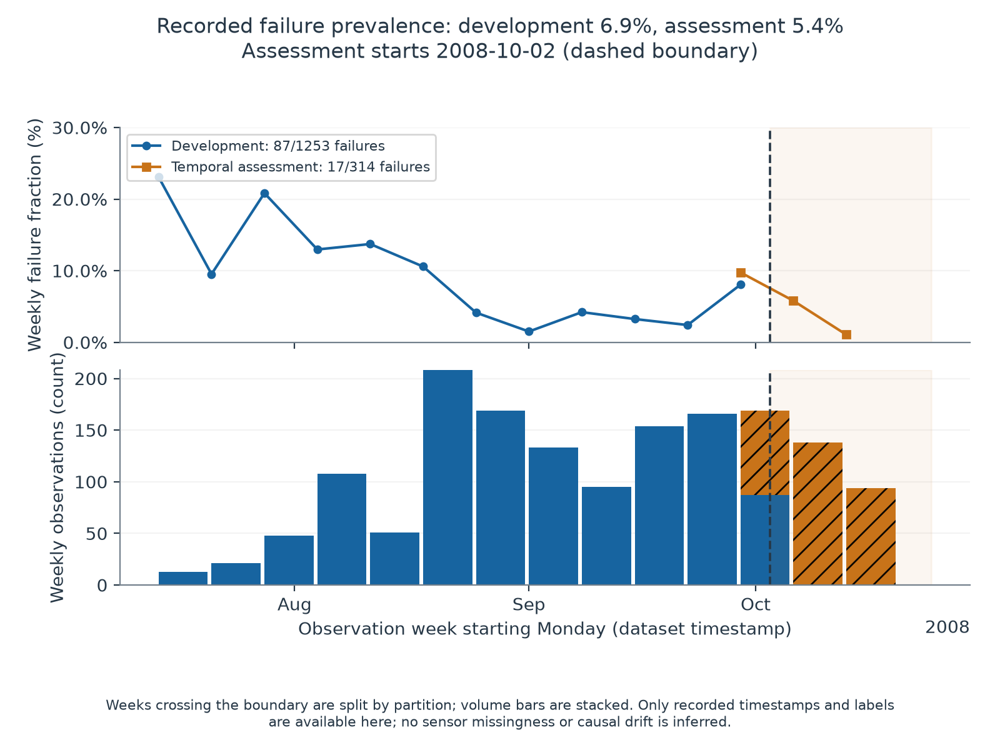
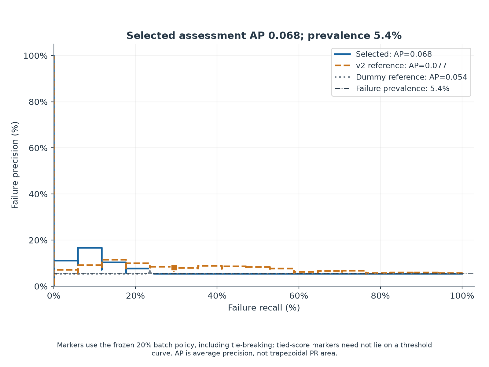
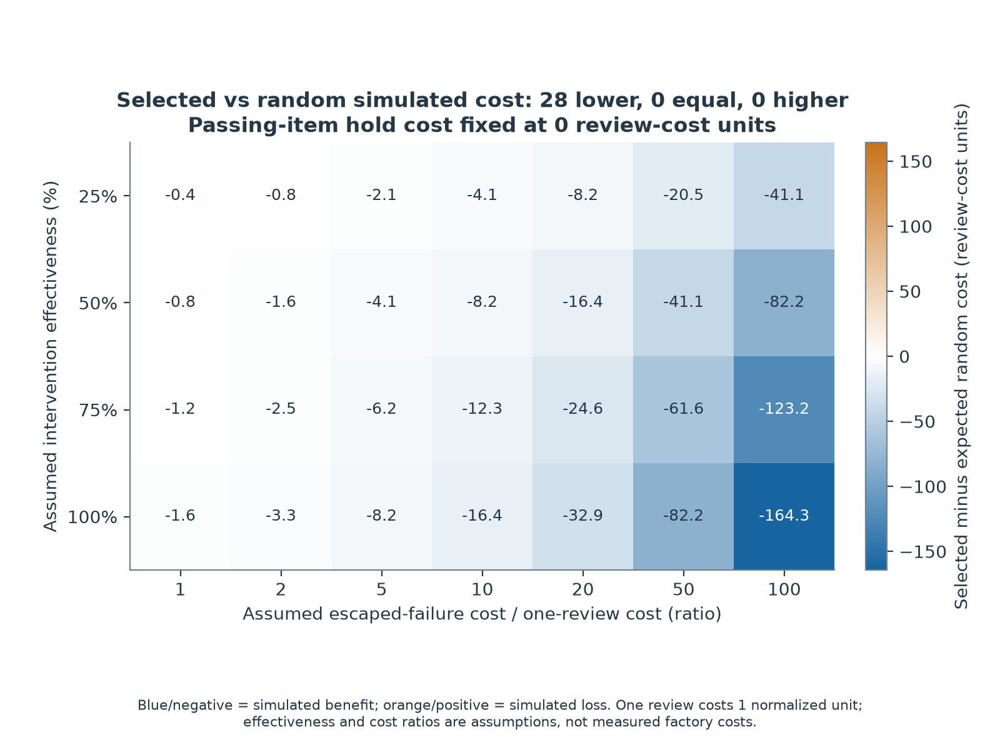

# SECOM Smart Manufacturing: Frozen Temporal Assessment

Generated from this completed run's result files; all numbers and figures are derived from those files.

**Selected flags 5/17 failures at 20% capacity; v2 flags 5/17.** The selected policy flags 29.4% of recorded failures using 62/314 reviews (19.7% of the batch), with 57 passing items flagged and precision 8.1%.

The count difference is **+0** flagged failures versus v2 and **+1.64** versus the random expectation of 3.36; these are descriptive comparisons on this assessment batch, not evidence of a guaranteed improvement.

## Scope And Dates

- Completed (UTC): `2026-11-03T01:07:58.859086+00:00`.
- Protocol frozen (UTC): `2026-11-03T01:02:30.698078+00:00`.
- Selection frozen (UTC): `2026-11-03T01:07:40.862624+00:00`.
- Development: 1253 observations, 87 failures (6.9%); `2008-07-19T11:55:00+00:00` through `2008-10-02T19:25:00+00:00`.
- Latest temporal assessment: 314 observations, 17 failures (5.4%); `2008-10-02T20:54:00+00:00` through `2008-10-17T06:07:00+00:00`.

The latest chronological block is protected from fitting, candidate selection, blend-member selection, and threshold selection within this run. SECOM and its labels were historically explored in v2; this is a protected within-run temporal boundary, not historically unseen or external validation.

## Frozen Development Selection

Selected candidate: **`knn_k100_neighbors5`**. Frozen members: `knn_k100_neighbors5`.

The protocol catalog contains **50 base candidates**, plus **1 development-derived rank blend**, giving **51 search entries**; 51 entries completed and appear in the search summary. The standard catalog is 50 base candidates plus one rank blend (51 total). The blend averages within-batch percentile ranks of the two highest-ranked supervised base candidates, with no weight tuning.

The primary objective is the **highest total true positives at exact per-block 20% review capacity** across 3 expanding chronological development blocks. Ties use higher mean block AP, then fixed catalog order; the blend comes last on exact ties. The assessment results do not select or reselect a model, threshold, blend, or operating budget.

| Rank | Candidate | Forward failures flagged / total | Recall | Mean block AP |
|---:|---|---:|---:|---:|
| 1 | `knn_k100_neighbors5` | 12/28 | 42.9% | 0.083 |
| 2 | `rank_blend_top2` | 11/28 | 39.3% | 0.209 |
| 3 | `rf_leaf2_none` | 11/28 | 39.3% | 0.192 |
| 4 | `xgb_k100_depth2_weighttrain_ratio` | 11/28 | 39.3% | 0.148 |
| 5 | `xgb_kall_depth2_weight1` | 11/28 | 39.3% | 0.141 |
| 6 | `rf_leaf8_none` | 11/28 | 39.3% | 0.138 |
| 7 | `xgb_k100_depth3_weight1` | 11/28 | 39.3% | 0.134 |
| 8 | `v2_rf_knn_smote` | 11/28 | 39.3% | 0.127 |
| 9 | `xgb_kall_depth2_weighttrain_ratio` | 10/28 | 35.7% | 0.161 |
| 10 | `rf_leaf2_balanced` | 10/28 | 35.7% | 0.121 |
| 11 | `knn_k30_neighbors21` | 10/28 | 35.7% | 0.115 |
| 12 | `balanced_rf_leaf2` | 10/28 | 35.7% | 0.097 |

| Selected candidate forward block | Training rows | Validation rows | Failures flagged / total | Block AP |
|---:|---:|---:|---:|---:|
| 1 | 501 | 250 | 5/8 | 0.110 |
| 2 | 751 | 251 | 3/9 | 0.079 |
| 3 | 1002 | 251 | 4/11 | 0.060 |

The development search selected `knn_k100_neighbors5` with 12/28 failures flagged, and the figure compares the top 12 candidates' recall and mean block AP. These reused development blocks support selection and are not an independent performance estimate or an assessment-based leaderboard.

## Primary Completed-Batch Policy

Every strategy ranks the same completed assessment batch and reviews exactly `floor(0.2 * 314) = 62` items, with highest scores first. Tied scores use the stored seed and original row IDs through SHA-256 ordering, never labels; the prior dummy therefore represents one deterministic tie-broken allocation, while theoretical random review is an expectation over allocations.

| Strategy | Reviews | TP | FN | FP | TN | Recall | Precision | Lift vs prevalence | AP |
|---|---:|---:|---:|---:|---:|---:|---:|---:|---:|
| Selected | 62 | 5 | 12 | 57 | 240 | 29.4% | 8.1% | 1.490 | 0.068 |
| v2 reference | 62 | 5 | 12 | 57 | 240 | 29.4% | 8.1% | 1.490 | 0.077 |
| Dummy reference | 62 | 4 | 13 | 58 | 239 | 23.5% | 6.5% | 1.192 | 0.054 |
| Random (theoretical expectation) | 62 | 3.36 | 13.64 | 58.64 | 238.36 | 19.7% | 5.4% | 1.000 | N/A |

Precision is TP / (TP + FP), recall is TP / (TP + FN), and lift is precision / assessment failure prevalence, all calculated from the actual confusion counts. Undefined rates are N/A; a constant-score dummy's AP is the assessment prevalence when both label classes are present.

The stored theoretical random-review expectation is **3.36 failures**, with stored 95% hypergeometric catch range **[1, 7]** for sampling 62 of 314 items without replacement with 17 failures. This range describes the number caught by a random allocation, not a confidence interval for a model difference or a significance test.

At the same 20% budget, the selected model flags 5/17 failures and 57 passing items, compared with 5/17 failures for v2 and 3.36 failures expected under random review. These are batch review outcomes on recorded labels, and additional flagged failures do not establish higher production yield.

## Detection Across Review Budgets

The lines show failures flagged by each frozen score ranking at 5%, 10%, 20%, 30%, and 50% review budgets, with selected-model labels giving caught count / total failures. This is a completed-batch ranking sensitivity analysis, not a measured increase in production capacity, a new model selection, or a live arrival-by-arrival review guarantee.

## Temporal Composition

Weekly failure fractions and observation counts show development prevalence 6.9% and assessment prevalence 5.4%, with the dashed line marking the first assessment timestamp and boundary weeks split by partition. The available manifest contains timestamps and labels only, so this plot cannot establish sensor missingness, feature drift, causality, or feature availability at decision time.

## Ranking And Conditional Uncertainty

Selected assessment AP: **0.068**, with the stored conditional 95% bootstrap interval **[0.052, 0.146]**. This interval uses a fixed-score, class-stratified bootstrap conditional on the fitted model and observed assessment prevalence; it does not include candidate-search uncertainty, training variation, temporal dependence, or uncertainty in future production conditions.

Selected recall: **29.4%**, with stored Wilson 95% interval **[0.133, 0.531]**. One additional flagged failure changes recall by 5.88 percentage points.

The selected, v2, and dummy curves compare score rankings against assessment failure prevalence 5.4%, and markers show the frozen 20% review decisions. AP is average precision rather than trapezoidal PR area, scores are not calibrated probabilities, and tie-broken capacity points need not lie on a score-threshold curve.

## Strictly Secondary F2 Threshold

`selection.threshold_policy` records a five-fold stratified development OOF maximum-F2 threshold of **0.193147**, with at most **250** development OOF alerts (20% of development rows, rounded down). The development policy actually issues 221 alerts (17.6%), flags 35/87 failures, and has F2 0.308 on the labels used to choose it.

Applied unchanged to assessment scores, this secondary threshold issues **44/314 alerts (14.0%)**, flags 3/17 failures, produces 41 false alerts, and has precision 6.8%, recall 17.6%, and F2 0.134. The OOF alert constraint does not guarantee at most 20% alerts after refitting or in live use; this threshold is strictly secondary and never replaces the primary batch-capacity result.

## Hypothetical Cost Sensitivity

The stored simulation uses `C = reviews + (P - a * TP) * escapeCost + FP * holdCost`, where P is the assessment failure count, a is assumed intervention effectiveness, and one review costs one normalized unit. An intervention averts only the assumed fraction of flagged failures; false alerts incur the assumed additional passing-item hold cost. These assumptions are not observed costs, estimated intervention effects, or measured savings.

With passing-item hold cost fixed at zero, selected-minus-expected-random cost is lower in 28, equal in 0, and higher in 0 of the 28 combinations of escape-cost ratios [1, 2, 5, 10, 20, 50, 100] and intervention effectiveness [25%, 50%, 75%, 100%]. Negative blue cells indicate simulated benefit and positive orange cells simulated loss under those assumptions; neither color establishes actual financial, yield, or throughput gains.

The illustrative slice below uses escape cost 20 and effectiveness 50%, with passing-item hold cost 0 or 2, all in normalized review-cost units. The complete stored grid includes no additional review, review everything, theoretical random review, the selected model, v2, and the dummy; this slice is not an optimized or empirically estimated cost setting.

| Stored strategy | Passing-item hold cost | Simulated total cost | Difference vs expected random |
|---|---:|---:|---:|
| `dummy_reference` | 0 | 362.00 | -6.43 |
| `no_additional_review` | 0 | 340.00 | -28.43 |
| `random_same_capacity_expected` | 0 | 368.43 | +0.00 |
| `review_everything` | 0 | 484.00 | +115.57 |
| `selected` | 0 | 352.00 | -16.43 |
| `v2_reference` | 0 | 352.00 | -16.43 |
| `dummy_reference` | 2 | 478.00 | -7.72 |
| `no_additional_review` | 2 | 340.00 | -145.72 |
| `random_same_capacity_expected` | 2 | 485.72 | +0.00 |
| `review_everything` | 2 | 1078.00 | +592.28 |
| `selected` | 2 | 466.00 | -19.72 |
| `v2_reference` | 2 | 466.00 | -19.72 |

## Evidence And Interpretation Boundaries

The positive evidence is directly observable: a frozen development-selected ranking allocates exactly 62 reviews and identifies 5 recorded failures with 1.490 lift over assessment prevalence. Comparisons with the reference and random expectation above retain their observed direction, including ties or losses.

Budget refers to ranking an already completed batch, not expanding factory capacity. Availability of sensor features and labels at a real production decision time is unverified. Increased flagged failures must not be interpreted as increased production yield; no causal intervention, yield improvement, throughput increase, deployment reliability, or state-of-the-art performance is established by this retrospective study.

Small failure counts and repeated comparisons on shared development blocks leave selection uncertainty that the conditional AP interval does not resolve. Prior public-dataset exploration limits historical independence even though the current assessment boundary is frozen within this run.

- Protocol SHA-256: `1b757a40dd9b9ad81ce6ed9070041929698aef5ed96df5c3a0d2c5011cb95197`.
- Selection SHA-256: `eaa9ff06a0366e94866364e0b53b5b8836f7cdf0ac8eda20524585c090636e32`.
- Frozen configuration and catalog: [protocol.json](protocol.json).
- Frozen winner, members, and secondary threshold: [selection.json](selection.json).
- Counts, AP, intervals, dates, and environment: [metrics.json](metrics.json).
- Development search: [search_summary.csv](search_summary.csv) and [search_blocks.csv](search_blocks.csv).
- Assessment scores and primary decisions: [assessment_predictions.csv](assessment_predictions.csv).
- Recorded review-budget sweep: [assessment_budgets.csv](assessment_budgets.csv).
- Complete hypothetical strategy grid: [cost_scenarios.csv](cost_scenarios.csv).
- Recorded timestamps, partitions, and labels: [split_manifest.csv](split_manifest.csv).
