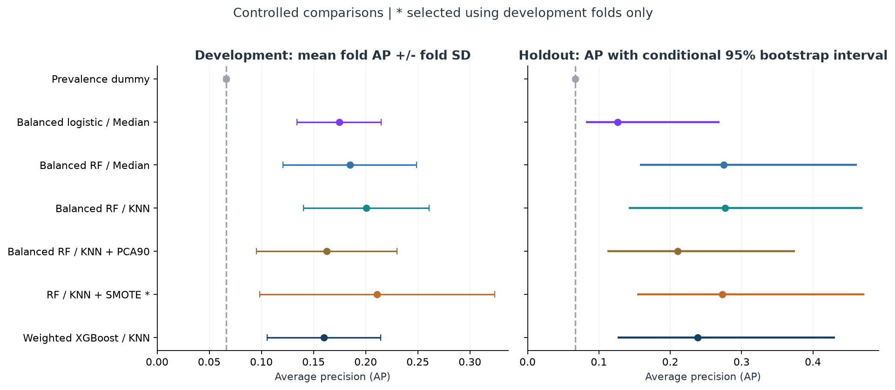
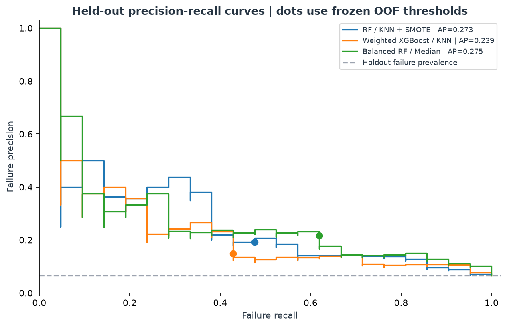
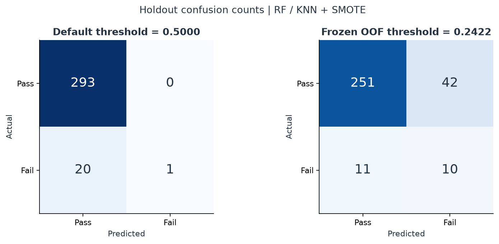

# Reproducible Experiment Results

Generated by `main.py`; tables and figures use the same run. Do not edit numbers by hand.

- Completed (UTC): `2026-11-02T20:32:51.977499+00:00`
- Source SHA-256: `c12ae2d547002062f2f93e6d613b5c2cf3f902ff7c4b8a0230be4c05a78e5f70`
- Frozen protocol SHA-256: `58e210ccd360a7de16b5f77c5be029e3888f96232e9bfd4c0765184253c5e2d2`
- Development: 1253 observations / 83 failures.
- Holdout: 314 observations / 21 failures.
- CV-selected candidate: **RF / KNN + SMOTE** (`rf_knn_smote`).

The selected candidate is determined by mean development-fold average precision (AP). All holdout comparisons below were produced after freezing that choice and every candidate's threshold. A different holdout ranking does not change the selection.

## Development Comparison

Fold SD describes variation across 5 overlapping training sets; it is not a confidence interval. OOF threshold F1 is optimized on these development labels and is optimistic.

| Candidate | Mean fold AP | Fold SD | Pooled OOF AP | OOF threshold | OOF selected F1 |
|---|---:|---:|---:|---:|---:|
| Prevalence dummy | 0.0662 | 0.0020 | 0.0654 | 0.065868 | 0.1243 |
| Balanced logistic / Median | 0.1746 | 0.0403 | 0.1582 | 0.572432 | 0.2314 |
| Balanced RF / Median | 0.1848 | 0.0642 | 0.1448 | 0.107041 | 0.2612 |
| Balanced RF / KNN | 0.2007 | 0.0602 | 0.1630 | 0.123735 | 0.2995 |
| Balanced RF / KNN + PCA90 | 0.1626 | 0.0675 | 0.1290 | 0.104359 | 0.2444 |
| RF / KNN + SMOTE | 0.2110 | 0.1128 | 0.1544 | 0.242222 | 0.2405 |
| Weighted XGBoost / KNN | 0.1601 | 0.0545 | 0.1289 | 0.136989 | 0.2332 |

## Frozen Holdout Comparison

AP evaluates ranking. Precision, recall, F1, and alarms below use each candidate's development-selected threshold. AP is `average_precision_score`, not trapezoidal PR area. Model scores have not been calibrated as physical failure probabilities.

| Candidate | AP | F1 @ 0.5 | Frozen precision | Frozen recall | Frozen F1 | Alarms | TP / FN / FP / TN |
|---|---:|---:|---:|---:|---:|---:|---|
| Prevalence dummy | 0.0669 | 0.0000 | 0.0669 | 1.0000 | 0.1254 | 314 | 21 / 0 / 293 / 0 |
| Balanced logistic / Median | 0.1264 | 0.0952 | 0.0750 | 0.1429 | 0.0984 | 40 | 3 / 18 / 37 / 256 |
| Balanced RF / Median | 0.2751 | 0.0000 | 0.2167 | 0.6190 | 0.3210 | 60 | 13 / 8 / 47 / 246 |
| Balanced RF / KNN | 0.2767 | 0.0000 | 0.2051 | 0.3810 | 0.2667 | 39 | 8 / 13 / 31 / 262 |
| Balanced RF / KNN + PCA90 | 0.2105 | 0.0000 | 0.1667 | 0.4286 | 0.2400 | 54 | 9 / 12 / 45 / 248 |
| RF / KNN + SMOTE | 0.2727 | 0.0909 | 0.1923 | 0.4762 | 0.2740 | 52 | 10 / 11 / 42 / 251 |
| Weighted XGBoost / KNN | 0.2386 | 0.1600 | 0.1475 | 0.4286 | 0.2195 | 61 | 9 / 12 / 52 / 241 |

## Selected-Candidate Uncertainty

- AP: **0.2727**, conditional bootstrap 95% interval **[0.1534, 0.4720]**.
- Failure recall: **0.4762**, Wilson 95% interval **[0.2834, 0.6763]**.
- Caught **10 of 21** failures; **42** false alarms among 293 passing observations.
- One additional detected failure changes holdout recall by **0.0476**.

95% recall Wilson intervals and class-stratified fixed-score AP bootstrap percentile intervals. Conditional on this sample/model and observed prevalence; not training, selection, historical-exploration or future-drift uncertainty.

## Chronological Sensitivity

A fixed XGBoost candidate is trained on earlier development timestamps and evaluated on the latest development portion. Three expanding-window folds inside the earlier portion choose its threshold. This check does not use the main holdout and does not select the main model.

- Earlier: 1002 observations / 69 failures; later: 251 observations / 14 failures.
- Last training timestamp: `2008-10-02T19:25:00`; first later timestamp: `2008-10-02T21:32:00`.
- Later AP: **0.0967**; prevalence: **0.0558**.
- Frozen threshold: **0.267113**; precision **0.0000**, recall **0.0000**, F1 **0.0000**.

## Figures

## Reproducibility And Limits

`protocol.json` freezes choices before evaluation. `split_manifest.csv`, `fold_metrics.csv`, `oof_predictions.csv`, and `holdout_predictions.csv` permit independent metric reconstruction. `metrics.json` contains raw-file hashes, package versions, configuration, and intervals.

SECOM was explored before this revision. These holdout rows are excluded from fitting and selection in this protocol, not historically unseen. A single small random split is not external validation. The temporal check is descriptive; no live factory cost, calibrated risk, causal sensor attribution, or production reliability is established. Do not compare the old test-tuned F1 directly with this protocol as if only the model changed.
