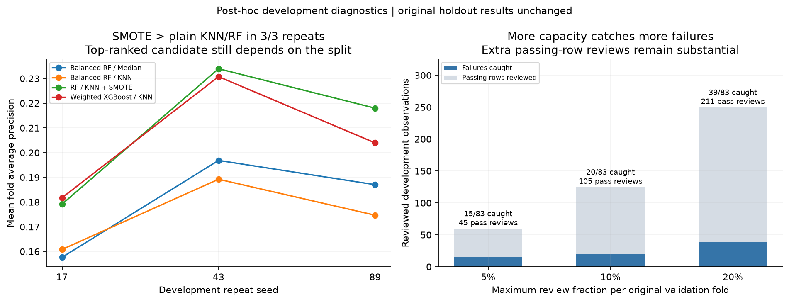

# Development Stability And Review Capacity

Supplementary, post-hoc development-only analysis. The original selected model, threshold, holdout predictions, and reported test metrics are unchanged.

Original protocol SHA-256: `58e210ccd360a7de16b5f77c5be029e3888f96232e9bfd4c0765184253c5e2d2`.

## Takeaways

- SMOTE has higher mean AP than plain KNN/RF in **3/3** matched repeats. The differences are descriptive; the highest-ranked candidate can still change across partitions.
- For the original selected pipeline, the review budget exposes a concrete workload/detection tradeoff: **5% cap: 60 reviews, 15/83 failures caught**; **10% cap: 125 reviews, 20/83 failures caught**; **20% cap: 250 reviews, 39/83 failures caught**.
- These completed checks strengthen the interpretation of the original study without replacing its selected model or reusing its holdout for another search.

## Sensitivity To Fold Assignment And Estimator Randomness

The same original development observations are reused with three new five-fold partitions. Each candidate uses the same partitions within a repeat. Splitter seed is the listed seed; estimator and SMOTE seed is that seed plus fold index. Rows are ordered by original row ID. Only four existing candidates are checked, with the original fixed hyperparameters.

| Candidate | Seed 17: mean AP (rank) | Seed 43: mean AP (rank) | Seed 89: mean AP (rank) | OOF threshold range |
|---|---:|---:|---:|---:|
| Balanced RF / Median | 0.1577 (4) | 0.1968 (3) | 0.1870 (3) | 0.1119-0.1202 |
| Balanced RF / KNN | 0.1608 (3) | 0.1892 (4) | 0.1747 (4) | 0.0934-0.1290 |
| RF / KNN + SMOTE | 0.1792 (2) | 0.2339 (1) | 0.2180 (1) | 0.2375-0.2628 |
| Weighted XGBoost / KNN | 0.1818 (1) | 0.2307 (2) | 0.2039 (2) | 0.1650-0.2496 |

Paired mean-AP differences (SMOTE minus plain KNN/RF), using matching repeats: **+0.0183**, **+0.0447**, **+0.0433**.

Ranks are among these four candidates. The repeats reuse observations and overlapping training samples; fold SD, rank counts, and AP ranges are descriptive, not independent confidence intervals, p-values, or probabilities of superiority. Thresholds are optimized development diagnostics and do not establish transfer to a full-development refit. These checks do not replace the original selection or justify a new holdout search.

## Hypothetical Review Capacity

The original OOF scores are ranked within each original validation fold. Each block may review at most floor(budget * block rows). Equal scores move together: a group that would exceed capacity and every lower group are excluded. A constant-score model can therefore issue no reviews. Aggregate metrics are computed from summed confusion counts, not averages of fold precision or recall.

| Candidate | Budget per fold | Maximum reviews | Actual reviews | Unused | TP | FP | FN | Precision | Recall |
|---|---:|---:|---:|---:|---:|---:|---:|---:|---:|
| Prevalence dummy | 5% | 60 | 0 | 60 | 0 | 0 | 83 | 0.0000 | 0.0000 |
| Prevalence dummy | 10% | 125 | 0 | 125 | 0 | 0 | 83 | 0.0000 | 0.0000 |
| Prevalence dummy | 20% | 250 | 0 | 250 | 0 | 0 | 83 | 0.0000 | 0.0000 |
| Balanced logistic / Median | 5% | 60 | 60 | 0 | 14 | 46 | 69 | 0.2333 | 0.1687 |
| Balanced logistic / Median | 10% | 125 | 125 | 0 | 24 | 101 | 59 | 0.1920 | 0.2892 |
| Balanced logistic / Median | 20% | 250 | 250 | 0 | 35 | 215 | 48 | 0.1400 | 0.4217 |
| Balanced RF / Median | 5% | 60 | 60 | 0 | 12 | 48 | 71 | 0.2000 | 0.1446 |
| Balanced RF / Median | 10% | 125 | 125 | 0 | 23 | 102 | 60 | 0.1840 | 0.2771 |
| Balanced RF / Median | 20% | 250 | 250 | 0 | 38 | 212 | 45 | 0.1520 | 0.4578 |
| Balanced RF / KNN | 5% | 60 | 60 | 0 | 12 | 48 | 71 | 0.2000 | 0.1446 |
| Balanced RF / KNN | 10% | 125 | 125 | 0 | 29 | 96 | 54 | 0.2320 | 0.3494 |
| Balanced RF / KNN | 20% | 250 | 250 | 0 | 36 | 214 | 47 | 0.1440 | 0.4337 |
| Balanced RF / KNN + PCA90 | 5% | 60 | 60 | 0 | 11 | 49 | 72 | 0.1833 | 0.1325 |
| Balanced RF / KNN + PCA90 | 10% | 125 | 125 | 0 | 21 | 104 | 62 | 0.1680 | 0.2530 |
| Balanced RF / KNN + PCA90 | 20% | 250 | 250 | 0 | 41 | 209 | 42 | 0.1640 | 0.4940 |
| RF / KNN + SMOTE | 5% | 60 | 60 | 0 | 15 | 45 | 68 | 0.2500 | 0.1807 |
| RF / KNN + SMOTE | 10% | 125 | 125 | 0 | 20 | 105 | 63 | 0.1600 | 0.2410 |
| RF / KNN + SMOTE | 20% | 250 | 250 | 0 | 39 | 211 | 44 | 0.1560 | 0.4699 |
| Weighted XGBoost / KNN | 5% | 60 | 60 | 0 | 10 | 50 | 73 | 0.1667 | 0.1205 |
| Weighted XGBoost / KNN | 10% | 125 | 125 | 0 | 20 | 105 | 63 | 0.1600 | 0.2410 |
| Weighted XGBoost / KNN | 20% | 250 | 250 | 0 | 34 | 216 | 49 | 0.1360 | 0.4096 |

Budget flooring is per block; a 5% budget across the original five folds allows 60 reviews in total, before tie exclusions. These random validation folds are hypothetical blocks, not actual factory inspection batches. Reusing development outcomes for model selection and policy exploration makes retrospectively preferred policies optimistic. No inspection costs, prevented losses, or future capacity compliance are established.

## Evidence And Reproduction

- `provenance.json`: original evidence hashes, supplementary source hashes, package versions, fixed configuration and seed policy.
- `repeat_metrics.csv`, `repeat_fold_metrics.csv`, `repeat_assignments.csv`, `repeat_oof_predictions.csv`: every repeated score and membership for reconstruction.
- `capacity_by_fold.csv`, `capacity_summary.csv`: review constraints and confusion counts from the original OOF predictions.

Run `uv run python -m scripts.development_diagnostics`. An existing output directory requires `--overwrite`. The analysis reads original development membership, not a new outer split. It never fits on or predicts the original holdout. The raw-data loader still validates the full published source files.
